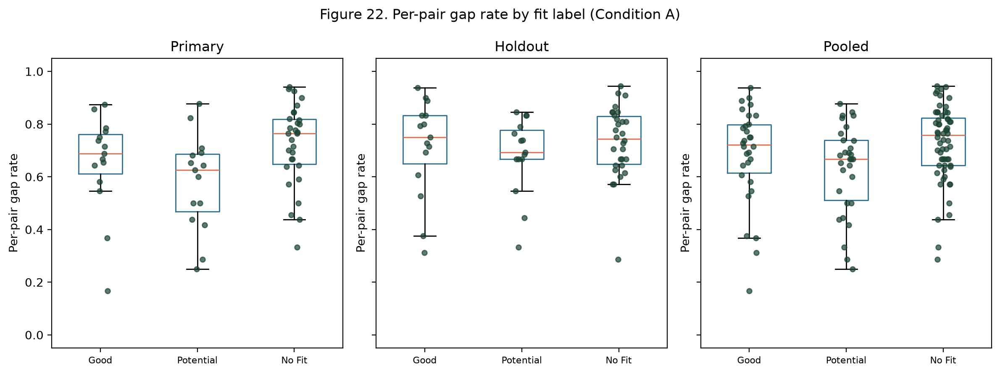
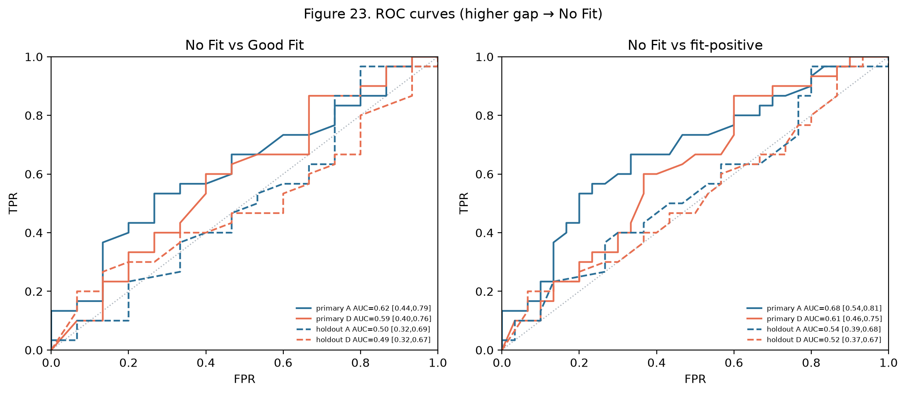
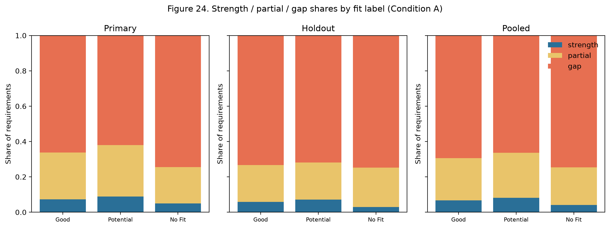
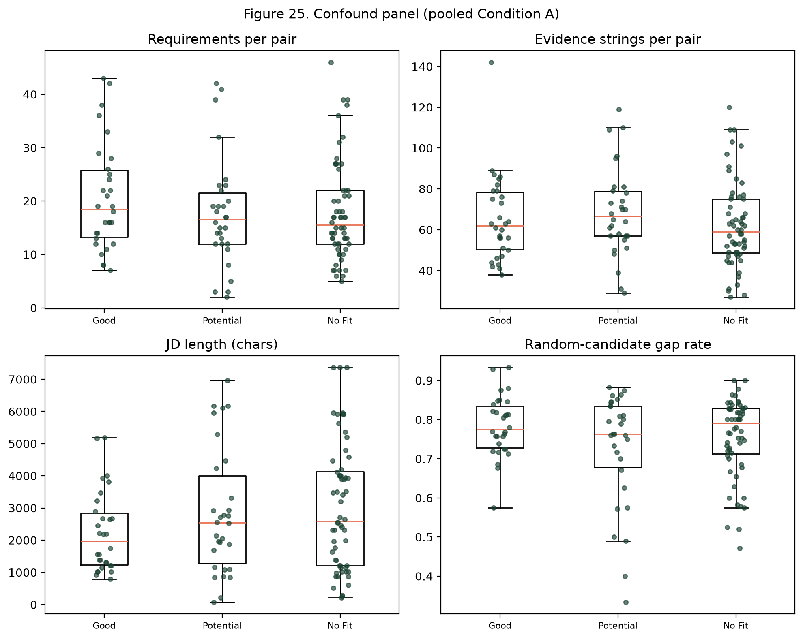

# Fit-label control: gap matrix vs independent human fit labels

Analysis of whether the profile-gap matrix tracks the Hugging Face dataset
`cnamuangtoun/resume-job-description-fit` labels (No Fit / Potential Fit / Good Fit).
Those labels are assigned independently of InterviewIQ scoring (they are not derived
from TF-IDF, BM25, or semantic similarity in this codebase).

**This hypotheses section was written before any sampling, extraction, scoring, or
statistical run for this analysis. It must not be edited after that point.**

---

## Pre-registered hypotheses and decision rules

*(Frozen. Do not edit.)*

### H1 (gradient)

Per-pair gap rate is ordered **No Fit > Potential Fit > Good Fit**. Equivalently,
strength share and mean combined score are ordered the other way
(Good Fit > Potential Fit > No Fit).

### H2 (negative control)

Per-pair gap rate (and mean combined score) separates **No Fit** from **Good Fit**;
ROC AUC > 0.5. The same holds for No Fit vs fit-positive (Good + Potential) pairs.

### H3 (adjacent classes)

Potential Fit differs from Good Fit. This contrast is expected to be weak; the
dataset’s labels overlap heavily. A null result here is **not** treated as failure
of the method.

### Decision rules (apply literally)

- If No Fit vs Good Fit is significant (Holm-adjusted p < 0.05) with AUC ≥ 0.65
  in **BOTH** splits → “the gap matrix tracks human fit labels at the coarse level”.
- If significant in **one split only** → “partial/inconsistent support”.
- If **neither** → “the gap matrix does not separate fit labels; possible reasons:
  label noise, extraction, scoring; do not claim validation”. Report it as such.
- **Never claim H1 monotonic** unless the Jonckheere-Terpstra trend test **AND**
  both adjacent differences point the right way.

---

## Code inspection

### Fit labels on pair subsets

Subset manifests (`experiment_pairs/manifest.json`, `experiment_pairs_holdout30/manifest.json`, `experiment_pairs_150/manifest.json`) store `pair_id`, `profile_id`, `jd_id`, `label` (`Good Fit` / `Potential Fit`), `label_id` (Good=2, Potential=1, No Fit=0 in `LABEL_TO_ID`), and relative `profile_path` / `job_path`. Extraction and gap JSONs copy `fit_label` from the runner combo (manifest `label`). Sampling is `sample_experiment_pairs` in `backend/app/services/datasets/resume_fit.py`: pandas `DataFrame.sample(n=…, random_state=seed)` per requested label on the **train** split, then a global shuffle with the same seed. Primary-30 is seed 42, 15 Good + 15 Potential (reconstructed exactly). Primary-150 is seed 42, 75 per fit-positive label (reconstructed exactly). Holdout-30 is a 15+15 subset of the 150-pool disjoint from primary-30; config seed is 2026, but that draw is **not** reproduced by `sample_experiment_pairs(..., seed=2026)` on the remaining 150 rows (documented as a deviation for NF-holdout, which uses seed 2026 on remaining No Fit train rows).

### Mapping pairs to extraction / gap JSON

Filenames: `{profile_id}__{jd_id}__{seniority}.json` with seniority `mid`. Extraction lives in `experiments/results/<exp>/extraction/`; production gap in `…/gap_analysis/`. Primary extraction `exp_20260927T205741Z`, gap `exp_20260927T215232Z`. Holdout extraction `exp_20260927T221621Z`, gap `exp_20260927T223303Z`. `pair_id` equals `profile_id` / `jd_id` for this dataset (one resume and one JD file per pair).

### How gap and gap_sensitivity consume extraction

`experiments/run.py` `run_gap_combo` validates `candidate` / `job` with Pydantic and calls `build_gap_matrix`. `gap_sensitivity` loads the same extraction records, builds evidence via `build_evidence`, and scores with `score_requirements` (Condition A = `_candidate_texts`). Raw CV for Condition D is `pairs_dir/profiles/{profile_id}.txt`.

### Per-pair fields

- **JD / CV length:** not stored on extraction JSON; taken from the pair text files (`len` of UTF-8 text).
- **Requirements:** `job.required_skills` then `job.preferred_skills` (`_job_competencies`); count = `len(gap_matrix.gaps)`.
- **Priority:** `required` / `preferred` / `unspecified`; production `ProfileGap.weight` also folds match severity and evidence (not a pure priority weight).
- **Evidence-string count:** `len(_candidate_texts(candidate))` under Condition A (~67 on fit-positive runs, as previously reported).
- Stored gap JSON also has per-requirement TF-IDF / BM25 / semantic / combined label.

### Repeated job descriptions (matched-job feasibility)

Train split cache: 6241 rows, 280 unique JDs, 642 unique resumes. **243 / 280** jobs appear with more than one fit label; **243** have both No Fit and (Good or Potential); **115** have No Fit and Good Fit; **72** have all three labels. All **100** unique JDs in the used fit-positive files also appear as No Fit in train. Primary-30 has 30 unique JDs; holdout-30 has 28. Within those 60-pair samples, no JD appears with two fit labels *inside the sample*. **52** unique JDs from primary+holdout have 831 No Fit rows in train — extra extraction of one No Fit resume per overlapping job is estimated in the dry-run and included only if it fits `--max-cost`.

### Production scoring (unchanged)

Weights 0.25 TF-IDF + 0.25 BM25_norm + 0.50 semantic; strong ≥ 0.65, partial ≥ 0.40, weak ≥ 0.20, else missing; gap = weak + missing. Extraction model `gpt-5.6-luna`, prompt versions 1.0.0 / 1.0.0. Existing `experiments/results/exp_*` artifacts are not modified by this analysis.

<!-- GENERATED_BELOW -->

## Method

Train-split pairs from `cnamuangtoun/resume-job-description-fit`. NF-primary-30: 30 No Fit pairs, `sample_experiment_pairs` with seed 42, excluding all pair ids in primary-30 / holdout-30 / primary-150. NF-holdout-30: 30 No Fit pairs, seed 2026, additionally excluding NF-primary-30. Fit-positive comparison sets are the existing Primary-30 (seed 42) and Holdout-30 (seed 2026) Good/Potential samples.

Scoring is Condition A (production `_candidate_texts`, weights 0.25 TF-IDF + 0.25 BM25_norm + 0.50 semantic, thresholds 0.65 / 0.40 / 0.20). Robustness: Condition D (raw CV chunks) and semantic-only labels with the same thresholds. Mismatched-candidate control: 5 permutations, same fit-label group, never self, seed 42.

- Git commit: `3c355badee2d407801153182212a0f470da55c95`
- Extraction model: `gpt-5.6-luna`
- Prompt versions: `{"candidate_profile": "1.0.0", "job_description": "1.0.0"}`
- Embedding: `all-MiniLM-L6-v2` on `cuda`
- Library versions: `{'numpy': '2.1.2', 'scipy': '1.18.1', 'scikit-learn': '1.9.1', 'torch': '2.8.0+cu128', 'sentence-transformers': '6.1.0', 'rank-bm25': '0.2.2', 'statsmodels': '0.15.0'}`

## Regression check

- **primary**: passed=true, counts_match_expected=true, counts=`{'requirements': 633, 'strong_match': 51, 'partial_match': 175, 'weak_match': 245, 'missing': 162}`, expected=`{'requirements': 633, 'strong_match': 51, 'partial_match': 175, 'weak_match': 245, 'missing': 162}`, label mismatches=0, score mismatches=0
- **holdout**: passed=true, counts_match_expected=true, counts=`{'requirements': 515, 'strong_match': 33, 'partial_match': 108, 'weak_match': 206, 'missing': 168}`, expected=`{'requirements': 515, 'strong_match': 33, 'partial_match': 108, 'weak_match': 206, 'missing': 168}`, label mismatches=0, score mismatches=0

## Cost and extraction failures

- Actual paid extraction cost (USD): **0.673245**
- Cached/reused pairs: 0
- Paid pair calls: 98
- Failed pairs: 0

No extraction failures were recorded.

## Descriptives (Condition A)

### Primary

| label | n pairs | n req | gap share | mean gap rate | 95% CI | mean combined | strength share |
| --- | --- | --- | --- | --- | --- | --- | --- |
| Good Fit | 15 | 341 | 0.6628 | 0.6536 | [0.5587, 0.7365] | 0.3430 | 0.0733 |
| Potential Fit | 15 | 292 | 0.6199 | 0.5795 | [0.4857, 0.6689] | 0.3845 | 0.0890 |
| No Fit | 30 | 599 | 0.7446 | 0.7238 | [0.6687, 0.7758] | 0.3110 | 0.0501 |

### Holdout

| label | n pairs | n req | gap share | mean gap rate | 95% CI | mean combined | strength share |
| --- | --- | --- | --- | --- | --- | --- | --- |
| Good Fit | 15 | 277 | 0.7329 | 0.7127 | [0.6125, 0.7952] | 0.3289 | 0.0578 |
| Potential Fit | 15 | 238 | 0.7185 | 0.6828 | [0.6064, 0.7478] | 0.3225 | 0.0714 |
| No Fit | 30 | 472 | 0.7479 | 0.7323 | [0.6838, 0.7790] | 0.3012 | 0.0297 |

### Pooled

| label | n pairs | n req | gap share | mean gap rate | 95% CI | mean combined | strength share |
| --- | --- | --- | --- | --- | --- | --- | --- |
| Good Fit | 30 | 618 | 0.6942 | 0.6831 | [0.6166, 0.7454] | 0.3359 | 0.0663 |
| Potential Fit | 30 | 530 | 0.6642 | 0.6312 | [0.5704, 0.6894] | 0.3535 | 0.0811 |
| No Fit | 60 | 1071 | 0.7460 | 0.7280 | [0.6905, 0.7646] | 0.3061 | 0.0411 |

## Gradient tests (per-pair gap rate, Condition A)

### Primary

- Kruskal-Wallis: H=7.2912, p=0.0261
- Jonckheere-Terpstra (Good < Potential < No Fit, greater, 10000 perms, seed 42): S=690.0000, p=0.0388
- Spearman (ordinal 0/1/2 vs gap rate): ρ=0.2385, p=0.0665
- H1 monotonic claim allowed: false

| comparison | U | p | Holm p | Cliff δ | δ 95% CI | direction_ok |
| --- | --- | --- | --- | --- | --- | --- |
| No Fit vs Potential Fit | 332.0000 | 0.0103 | 0.0310 | 0.4756 | [0.1377, 0.7734] | true |
| No Fit vs Good Fit | 279.5000 | 0.1934 | 0.3292 | 0.2422 | [-0.1156, 0.5845] | true |
| Potential Fit vs Good Fit | 78.5000 | 0.1646 | 0.3292 | -0.3022 | [-0.7023, 0.0979] | false |

### Holdout

- Kruskal-Wallis: H=1.0521, p=0.5909
- Jonckheere-Terpstra (Good < Potential < No Fit, greater, 10000 perms, seed 42): S=579.0000, p=0.4049
- Spearman (ordinal 0/1/2 vs gap rate): ρ=0.0329, p=0.8028
- H1 monotonic claim allowed: false

| comparison | U | p | Holm p | Cliff δ | δ 95% CI | direction_ok |
| --- | --- | --- | --- | --- | --- | --- |
| No Fit vs Potential Fit | 263.0000 | 0.3657 | 1.0000 | 0.1689 | [-0.1802, 0.5111] | true |
| No Fit vs Good Fit | 225.5000 | 1.0000 | 1.0000 | 0.0022 | [-0.3689, 0.3801] | true |
| Potential Fit vs Good Fit | 90.5000 | 0.3717 | 1.0000 | -0.1956 | [-0.5957, 0.2268] | false |

### Pooled

- Kruskal-Wallis: H=6.6347, p=0.0362
- Jonckheere-Terpstra (Good < Potential < No Fit, greater, 10000 perms, seed 42): S=2554.0000, p=0.0629
- Spearman (ordinal 0/1/2 vs gap rate): ρ=0.1390, p=0.1299
- H1 monotonic claim allowed: false

| comparison | U | p | Holm p | Cliff δ | δ 95% CI | direction_ok |
| --- | --- | --- | --- | --- | --- | --- |
| No Fit vs Potential Fit | 1198.0000 | 0.0108 | 0.0325 | 0.3311 | [0.0861, 0.5579] | true |
| No Fit vs Good Fit | 1006.5000 | 0.3641 | 0.3641 | 0.1183 | [-0.1495, 0.3695] | true |
| Potential Fit vs Good Fit | 349.5000 | 0.1391 | 0.2783 | -0.2233 | [-0.5089, 0.0457] | false |

## Discrimination (AUC)

| split | condition | contrast | AUC | CI low | CI high |
| --- | --- | --- | --- | --- | --- |
| primary | A | no_fit_vs_good | 0.6211 | 0.4428 | 0.7912 |
| primary | A | no_fit_vs_fit_positive | 0.6794 | 0.5381 | 0.8077 |
| primary | D | no_fit_vs_good | 0.5856 | 0.4010 | 0.7567 |
| primary | D | no_fit_vs_fit_positive | 0.6128 | 0.4627 | 0.7475 |
| primary | semantic | no_fit_vs_good | 0.6378 | 0.4679 | 0.7909 |
| primary | semantic | no_fit_vs_fit_positive | 0.6800 | 0.5327 | 0.8092 |
| holdout | A | no_fit_vs_good | 0.5011 | 0.3214 | 0.6915 |
| holdout | A | no_fit_vs_fit_positive | 0.5428 | 0.3914 | 0.6808 |
| holdout | D | no_fit_vs_good | 0.4933 | 0.3184 | 0.6706 |
| holdout | D | no_fit_vs_fit_positive | 0.5211 | 0.3660 | 0.6658 |
| holdout | semantic | no_fit_vs_good | 0.6600 | 0.4798 | 0.8288 |
| holdout | semantic | no_fit_vs_fit_positive | 0.6917 | 0.5458 | 0.8163 |
| pooled | A | no_fit_vs_good | 0.5592 | 0.4303 | 0.6871 |
| pooled | A | no_fit_vs_fit_positive | 0.6124 | 0.5108 | 0.7091 |
| pooled | D | no_fit_vs_good | 0.5353 | 0.4110 | 0.6561 |
| pooled | D | no_fit_vs_fit_positive | 0.5647 | 0.4623 | 0.6654 |
| pooled | semantic | no_fit_vs_good | 0.6633 | 0.5452 | 0.7742 |
| pooled | semantic | no_fit_vs_fit_positive | 0.6936 | 0.5958 | 0.7813 |

## Robustness (Condition D and semantic-only)

See combined CSVs under `experiments/results/fit_label_control_combined/`. Headline AUC values are in the table above.

## Confound audit

- **JD length (chars)**: KW p=0.3132, means=`{'Good Fit': 2242.366666666667, 'Potential Fit': 2854.6, 'No Fit': 3026.8}`
- **requirements per pair**: KW p=0.3954, means=`{'Good Fit': 20.6, 'Potential Fit': 17.666666666666668, 'No Fit': 17.85}`
- **share required vs preferred**: KW p=0.0361, means=`{'Good Fit': 0.7776814049758275, 'Potential Fit': 0.8831411591994623, 'No Fit': 0.8610663455927268}`
- **CV length (chars)**: KW p=0.7858, means=`{'Good Fit': 5767.833333333333, 'Potential Fit': 5690.966666666666, 'No Fit': 5479.816666666667}`
- **evidence strings per pair**: KW p=0.2998, means=`{'Good Fit': 65.23333333333333, 'Potential Fit': 68.6, 'No Fit': 62.266666666666666}`
- **random-candidate (mismatched) gap rate**: KW p=0.5579, means=`{'Good Fit': 0.7835175907708174, 'Potential Fit': 0.7269276753358955, 'No Fit': 0.7552938769205642}`
  - With mismatched evidence the pair fit label is meaningless. A significant Kruskal-Wallis indicates a job-side confound.
- **true minus random-candidate gap share**: KW p=null, means=`{'Good Fit': -0.10037021259331436, 'Potential Fit': -0.0957663064209841, 'No Fit': -0.027257645861858037}`

Secondary OLS (HC3), low-powered:
- n=120, R²=0.1656
- intercept_GoodFit: coef=0.7077 [0.5947, 0.8206] p=0.0000
- PotentialFit_vs_Good: coef=-0.0296 [-0.1185, 0.0593] p=0.5136
- NoFit_vs_Good: coef=0.0553 [-0.0214, 0.1320] p=0.1575
- n_requirements: coef=0.0049 [0.0016, 0.0082] p=0.0037
- evidence_strings: coef=-0.0018 [-0.0032, -0.0005] p=0.0074
- jd_length: coef=-0.0000 [-0.0000, 0.0000] p=0.7334

## Matched-job analysis

Matched-job extra pairs proposed=38, uncached=38, estimated extra USD=0.27032022. Included under --max-cost. Paired Wilcoxon on 52 jobs with both sides in the scored set: p=0.04009302215777456, rank_biserial=0.33031674208144796 (No Fit gap vs fit-positive gap, within job).

## Figures

## Pre-registered decision-rule outcome

**the gap matrix does not separate fit labels; possible reasons: label noise, extraction, scoring; do not claim validation**

- Primary No Fit vs Good Fit: Holm p=0.3292, AUC=0.6211, significant_coarse=false
- Holdout No Fit vs Good Fit: Holm p=1.0000, AUC=0.5011, significant_coarse=false
- H1 monotonic claim allowed on both splits: false (must not claim H1 unless this is true).

## Limitations

- Small n (30 No Fit / 15 Potential / 15 Good per split).
- Human fit labels in this dataset are noisy; adjacent classes overlap.
- Job-family and document-length confounds are possible; see the confound audit.
- Single dataset (`cnamuangtoun/resume-job-description-fit`, train split).
- Semantic similarity is still in the *score*; labels are independent of our scorer, which is the point of this control, but extraction quality still affects scores.

## Deviations from the spec

- Holdout-30 fit-positive pair ids could not be reconstructed from `sample_experiment_pairs` with seed 2026 on the 150-pool; NF-holdout uses seed 2026 on remaining No Fit train rows (the documented holdout seed), not a reverse-engineered undocumented holdout filter.
- Priority-weighted gap share uses requirement priority base weights (required=1.0, preferred=0.6, unspecified=0.8), not stored match-dependent `ProfileGap.weight` (that weight includes severity and evidence and would mix the outcome into the weight).
- Mismatched control uses the existing `mismatched_partner_indices` per fit-label group so partners stay in the same human label.

## What this means for the thesis

Pre-registered decision-rule outcome: the gap matrix does not separate fit labels; possible reasons: label noise, extraction, scoring; do not claim validation. No Fit vs Good Fit AUC (gap rate, Condition A) is 0.621 on primary and 0.501 on holdout. H1 monotonicity is not claimed: the JT-plus-adjacent-direction rule is not met on both splits. The random-candidate control did not show a significant label difference on the pooled mismatch rates reported in the confound section (see numbers there). No claim is made beyond what those tests support.

## Files

- `/root/interviewIQ/experiments/results/exp_20261003T163033Z`
- `/root/interviewIQ/experiments/results/fit_label_control_combined`
- `docs/figures/fig22_gap_rate_by_fit_label.png`
- `docs/figures/fig23_roc_fit_labels.png`
- `docs/figures/fig24_stacked_shares_by_fit_label.png`
- `docs/figures/fig25_confound_panel.png`
- `docs/fit_label_control_report.md`
- `experiments/datasets/resume_job_fit/experiment_pairs_nf_primary30`
- `experiments/datasets/resume_job_fit/experiment_pairs_nf_holdout30`