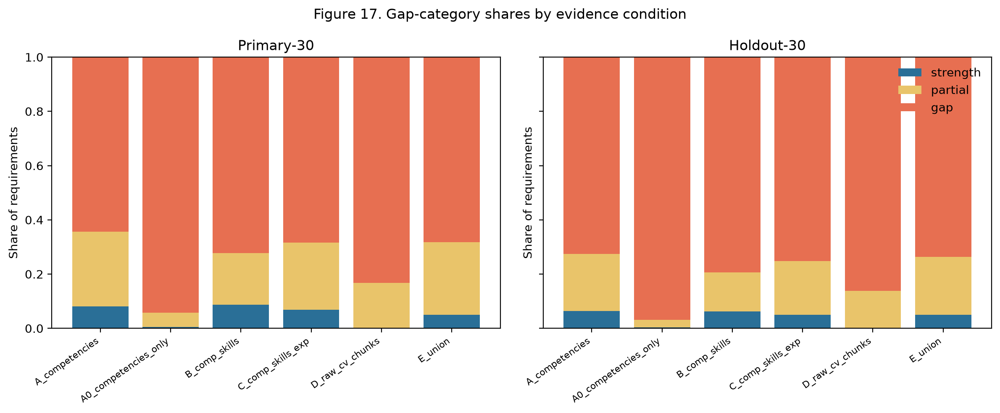
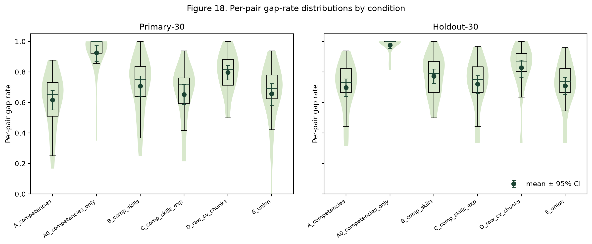
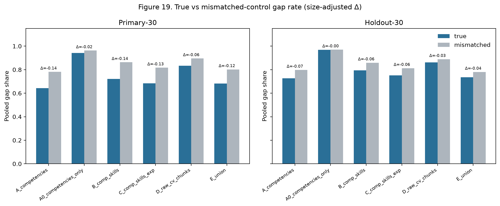
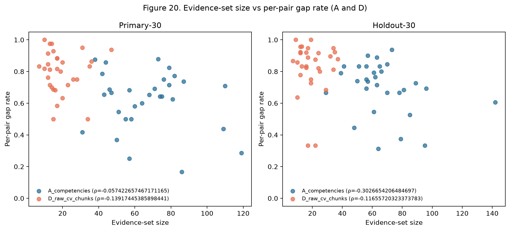
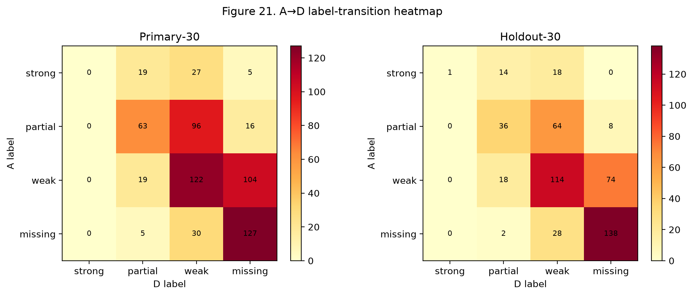

# Gap-matrix evidence-set sensitivity analysis

Local, zero-LLM-cost analysis of how candidate evidence-set construction affects profile-gap labels. Job requirements, score weights (0.25 TF-IDF / 0.25 BM25_norm / 0.50 semantic), thresholds (0.65 / 0.40 / 0.20), and the embedding model are held fixed.

- Primary experiment: `exp_20261003T042547Z` (source extraction `exp_20260927T205741Z`, stored gap `exp_20260927T215232Z`)
- Holdout experiment: `exp_20261003T042642Z` (source extraction `exp_20260927T221621Z`, stored gap `exp_20260927T223303Z`)
- Combined tables: `experiments/results/gap_sensitivity_combined/`
- Git commit: `4a144652a7fb5c12e107701ffe417c47afa32640`
- Embedding: `all-MiniLM-L6-v2` on `cuda`
- Library versions: `{'numpy': '2.1.2', 'scipy': '1.18.1', 'scikit-learn': '1.9.1', 'torch': '2.8.0+cu128', 'sentence-transformers': '6.1.0', 'rank-bm25': '0.2.2'}`

## Code inspection

### Gap-analysis service and entry points

- Core implementation: `backend/app/services/gap_analysis/matrix.py` (`build_gap_matrix`, `classify_match`, `_candidate_texts`, `_job_competencies`).
- API entry: `POST` pipeline path in `backend/app/api/v1/pipeline.py` calls `build_gap_matrix`.
- Experiment entry: `experiments/run.py` stage `gap_analysis` (`run_gap_combo` → `build_gap_matrix`).
- New stage: `gap_sensitivity` (this work) in `experiments/run.py`, implemented under `backend/app/services/gap_sensitivity/`.

### How candidate texts are assembled (production)

Production `_candidate_texts` (current code, and the code that produced the stored Primary/Holdout gap runs) builds a **deduplicated union** of:

- `technical_skills`, `soft_skills`, `domain_experience`, `certifications`, `competencies` (`normalized_label`)
- per experience entry: `technologies` and `responsibilities`

It does **not** currently include experience `achievements`, `title`, education entries, projects, or `professional_summary`.

**Important discrepancy vs the task brief:** the brief described Condition A as “extracted competency strings only”. That matches an *older* `_candidate_texts` that returned competencies when non-empty and only then fell back to skills/experience. The stored gap experiments (`exp_20260927T215232Z`, `exp_20260927T223303Z`) were produced with the **expanded** union above. Condition `A_competencies` in this analysis is therefore defined as **production `_candidate_texts`** so the regression check can reproduce stored counts. Condition `A0_competencies_only` is the sparse competencies-only counterfactual implied by the brief.

### BM25 normalisation

Raw BM25 is computed with `BM25Okapi` over the candidate evidence strings for that pair. `bm25_norm = bm25_raw / bm25_max`, where `bm25_max` is the **maximum raw BM25 across requirements for the same pair and evidence set**. Changing the evidence set therefore changes both raw scores and the normalisation constant — labels are not strictly comparable across conditions on the BM25 component alone.

**Mitigations used here:**

1. Primary reported labels use production normalisation (needed for regression fidelity on Condition A).
2. Each requirement also stores `bm25_norm_fixed` / `combined_fixed_bm25` using Condition A’s per-pair `bm25_max`.
3. Semantic-only metrics (same thresholds on the semantic score alone) are reported as the scale-free robustness check.

### TF-IDF fitting

`TfidfMatcher.similarity` fits a two-document TF-IDF vectorizer on `[job_requirement_label, candidate_blob]` where `candidate_blob` is the space-joined evidence list. The IDF/TF scale therefore also depends on the evidence blob. Semantic-only metrics again remove this confound.

### `CandidateProfile` fields relevant to evidence

Present in schema (`backend/app/schemas/domain.py`): `competencies`, `technical_skills`, `soft_skills`, `domain_experience`, `certifications`, `experience` (`title`, `responsibilities`, `achievements`, `technologies`), `education`, `projects`, `professional_summary`, `seniority_indicators`. Condition C uses title / responsibilities / achievements (schema has these fields — condition is not skipped).

### Mapping extraction JSON → pair IDs → raw CV

Extraction artifacts live in `experiments/results/<exp>/extraction/{profile_id}__{jd_id}__{seniority}.json` with `pair_id`, `profile_id`, `fit_label`, `candidate`, `job`. Raw CV text is loaded from the config `data.pairs_dir` as `profiles/{profile_id}.txt` (Primary: `experiment_pairs/`; Holdout: `experiment_pairs_150/` via `primary_hf_holdout30.yaml`).

### Ablation flags

`Settings` exposes `enable_tfidf`, `enable_bm25`, `enable_semantic`, `enable_gap_analysis`, `enable_competency_weighting`, `enable_mmr`, `enable_redundancy_filter`. Defaults remain unchanged; this stage does not toggle them.

### Runner `--stage` and artifact format

`experiments/run.py` accepts `--stage {extraction,gap_analysis,baseline,gap_sensitivity}`. Gap-sensitivity writes a new `experiments/results/exp_<UTC>/` with `summary.json`, `regression.json`, `pairs/*.json`, and `tables/*.csv`. Cross-split outputs go to `experiments/results/gap_sensitivity_combined/`.

## Method

### Conditions

- **A_competencies**: Production pipeline evidence via ``_candidate_texts``: technical/soft/domain skills, certifications, competencies, experience technologies and responsibilities (deduplicated). This is the stored-result baseline.
- **A0_competencies_only**: Extracted competency ``normalized_label`` strings only.
- **B_comp_skills**: Competencies + extracted technical skills (case-insensitive dedupe).
- **C_comp_skills_exp**: B + experience title, responsibility bullets, and achievement bullets.
- **D_raw_cv_chunks**: Raw CV sentence/bullet chunks (no extraction).
- **E_union**: Union of C and D.

### Mismatched-candidate control

For each pair and condition, job requirements are scored against another candidate’s evidence set from the same split (never self; 5 permutations; seed 42). Size-adjusted effect = true gap rate − mismatched gap rate.

### Statistics

Bootstrap 95% CIs use 2000 resamples over pairs (seed 42). Paired comparisons use Wilcoxon signed-rank tests with matched-pairs rank-biserial effect sizes. Dose-response uses Spearman correlation between per-pair evidence size and per-pair gap rate.

## Regression-check result

### Primary-30

- Passed score/label match: **True**
- Counts match expected: **True**
- Counts: `{'requirements': 633, 'strong_match': 51, 'partial_match': 175, 'weak_match': 245, 'missing': 162}`
- Expected: `{'requirements': 633, 'strong_match': 51, 'partial_match': 175, 'weak_match': 245, 'missing': 162}`
- Label mismatches: 0; score mismatches (tol=0.0001): 0; max |Δ combined|: 0.00000006

### Holdout-30

- Passed score/label match: **True**
- Counts match expected: **True**
- Counts: `{'requirements': 515, 'strong_match': 33, 'partial_match': 108, 'weak_match': 206, 'missing': 168}`
- Expected: `{'requirements': 515, 'strong_match': 33, 'partial_match': 108, 'weak_match': 206, 'missing': 168}`
- Label mismatches: 0; score mismatches (tol=0.0001): 0; max |Δ combined|: 0.00000006

## Results tables

### Requirement counts and gap shares

| Split | Condition | N | Strong | Partial | Weak | Missing | Gap share (95% CI) | Mean per-pair gap (95% CI) | Evid. size mean |
| --- | --- | ---: | ---: | ---: | ---: | ---: | --- | --- | ---: |
| primary-30 | A_competencies | 633 | 51 | 175 | 245 | 162 | 64.3% [58.1%, 70.2%] | 0.6166 [0.5519, 0.6791] | 67.07 |
| primary-30 | A0_competencies_only | 633 | 3 | 34 | 35 | 561 | 94.2% [89.2%, 97.8%] | 0.9250 [0.8680, 0.9726] | 2.77 |
| primary-30 | B_comp_skills | 633 | 55 | 121 | 181 | 276 | 72.2% [66.4%, 77.6%] | 0.7075 [0.6402, 0.7731] | 26.77 |
| primary-30 | C_comp_skills_exp | 633 | 43 | 157 | 259 | 174 | 68.4% [62.7%, 73.4%] | 0.6527 [0.5870, 0.7169] | 57.13 |
| primary-30 | D_raw_cv_chunks | 633 | 0 | 106 | 275 | 252 | 83.3% [78.2%, 87.5%] | 0.7968 [0.7487, 0.8424] | 19.27 |
| primary-30 | E_union | 633 | 32 | 169 | 291 | 141 | 68.2% [61.8%, 74.1%] | 0.6565 [0.5823, 0.7242] | 76.40 |
| holdout-30 | A_competencies | 515 | 33 | 108 | 206 | 168 | 72.6% [66.6%, 77.9%] | 0.6978 [0.6391, 0.7540] | 66.77 |
| holdout-30 | A0_competencies_only | 515 | 2 | 14 | 32 | 467 | 96.9% [94.5%, 98.9%] | 0.9745 [0.9533, 0.9905] | 2.57 |
| holdout-30 | B_comp_skills | 515 | 32 | 74 | 138 | 271 | 79.4% [74.0%, 84.1%] | 0.7720 [0.7245, 0.8196] | 26.97 |
| holdout-30 | C_comp_skills_exp | 515 | 26 | 102 | 197 | 190 | 75.1% [69.4%, 80.3%] | 0.7198 [0.6598, 0.7759] | 56.23 |
| holdout-30 | D_raw_cv_chunks | 515 | 1 | 70 | 224 | 220 | 86.2% [83.1%, 89.0%] | 0.8279 [0.7660, 0.8774] | 19.47 |
| holdout-30 | E_union | 515 | 26 | 110 | 224 | 155 | 73.6% [68.9%, 78.1%] | 0.7091 [0.6524, 0.7626] | 75.70 |

### Size-adjusted effects (true − mismatched pooled gap share)

| Split | Condition | True gap share | Mismatched gap share | Size-adjusted Δ |
| --- | --- | ---: | ---: | ---: |
| primary-30 | A_competencies | 64.3% | 78.1% | -0.1384 |
| primary-30 | A0_competencies_only | 94.2% | 96.2% | -0.0209 |
| primary-30 | B_comp_skills | 72.2% | 86.3% | -0.1409 |
| primary-30 | C_comp_skills_exp | 68.4% | 81.7% | -0.1327 |
| primary-30 | D_raw_cv_chunks | 83.3% | 89.5% | -0.0626 |
| primary-30 | E_union | 68.2% | 80.2% | -0.1194 |
| holdout-30 | A_competencies | 72.6% | 79.7% | -0.0711 |
| holdout-30 | A0_competencies_only | 96.9% | 97.0% | -0.0008 |
| holdout-30 | B_comp_skills | 79.4% | 85.9% | -0.0649 |
| holdout-30 | C_comp_skills_exp | 75.1% | 81.2% | -0.0610 |
| holdout-30 | D_raw_cv_chunks | 86.2% | 88.9% | -0.0264 |
| holdout-30 | E_union | 73.6% | 78.0% | -0.0443 |

### Wilcoxon vs Condition A (per-pair gap rate)

| Split | Condition | n | n≠0 | p | rank-biserial |
| --- | --- | ---: | ---: | ---: | ---: |
| primary-30 | A0_competencies_only | 30 | 29 | 0.0000 | 1.0000 |
| primary-30 | B_comp_skills | 30 | 19 | 0.0013 | 0.8421 |
| primary-30 | C_comp_skills_exp | 30 | 18 | 0.0210 | 0.6140 |
| primary-30 | D_raw_cv_chunks | 30 | 26 | 0.0000 | 1.0000 |
| primary-30 | E_union | 30 | 22 | 0.0376 | 0.5099 |
| holdout-30 | A0_competencies_only | 30 | 29 | 0.0000 | 0.9954 |
| holdout-30 | B_comp_skills | 30 | 21 | 0.0012 | 0.8009 |
| holdout-30 | C_comp_skills_exp | 30 | 11 | 0.0616 | 0.6364 |
| holdout-30 | D_raw_cv_chunks | 30 | 27 | 0.0002 | 0.8307 |
| holdout-30 | E_union | 30 | 16 | 0.6231 | 0.1471 |

### Spearman dose-response (evidence size vs per-pair gap rate)

| Split | Condition | ρ | p | n |
| --- | --- | ---: | ---: | ---: |
| primary-30 | A_competencies | -0.0574 | 0.7631 | 30 |
| primary-30 | A0_competencies_only | -0.7804 | 0.0000 | 30 |
| primary-30 | B_comp_skills | 0.1107 | 0.5604 | 30 |
| primary-30 | C_comp_skills_exp | -0.1105 | 0.5610 | 30 |
| primary-30 | D_raw_cv_chunks | -0.1392 | 0.4633 | 30 |
| primary-30 | E_union | -0.1514 | 0.4245 | 30 |
| holdout-30 | A_competencies | -0.3027 | 0.1040 | 30 |
| holdout-30 | A0_competencies_only | -0.5740 | 0.0009 | 30 |
| holdout-30 | B_comp_skills | 0.1600 | 0.3985 | 30 |
| holdout-30 | C_comp_skills_exp | -0.4117 | 0.0238 | 30 |
| holdout-30 | D_raw_cv_chunks | -0.1166 | 0.5396 | 30 |
| holdout-30 | E_union | -0.4016 | 0.0278 | 30 |

### Semantic-only robustness (pooled gap share)

| Split | Condition | Gap share (semantic-only) | Mean per-pair gap |
| --- | --- | ---: | ---: |
| primary-30 | A_competencies | 38.2% | 0.3763 |
| primary-30 | A0_competencies_only | 90.7% | 0.8793 |
| primary-30 | B_comp_skills | 52.8% | 0.5104 |
| primary-30 | C_comp_skills_exp | 43.3% | 0.4110 |
| primary-30 | D_raw_cv_chunks | 71.7% | 0.6831 |
| primary-30 | E_union | 41.1% | 0.3865 |
| holdout-30 | A_competencies | 45.2% | 0.4335 |
| holdout-30 | A0_competencies_only | 93.0% | 0.9401 |
| holdout-30 | B_comp_skills | 59.4% | 0.5662 |
| holdout-30 | C_comp_skills_exp | 51.1% | 0.4859 |
| holdout-30 | D_raw_cv_chunks | 73.2% | 0.7082 |
| holdout-30 | E_union | 48.5% | 0.4641 |

### Mean signal values

| Split | Condition | TF-IDF | BM25_norm | Semantic | Combined |
| --- | --- | ---: | ---: | ---: | ---: |
| primary-30 | A_competencies | 0.0599 | 0.3266 | 0.5119 | 0.3526 |
| primary-30 | A0_competencies_only | 0.0117 | 0.0552 | 0.1427 | 0.0880 |
| primary-30 | B_comp_skills | 0.0391 | 0.2608 | 0.4552 | 0.3026 |
| primary-30 | C_comp_skills_exp | 0.0581 | 0.3186 | 0.4855 | 0.3370 |
| primary-30 | D_raw_cv_chunks | 0.0534 | 0.3158 | 0.3354 | 0.2600 |
| primary-30 | E_union | 0.0584 | 0.3370 | 0.4909 | 0.3443 |
| holdout-30 | A_competencies | 0.0417 | 0.2886 | 0.4699 | 0.3175 |
| holdout-30 | A0_competencies_only | 0.0063 | 0.0404 | 0.1295 | 0.0764 |
| holdout-30 | B_comp_skills | 0.0274 | 0.2109 | 0.4195 | 0.2693 |
| holdout-30 | C_comp_skills_exp | 0.0403 | 0.2749 | 0.4456 | 0.3016 |
| holdout-30 | D_raw_cv_chunks | 0.0351 | 0.3082 | 0.3303 | 0.2510 |
| holdout-30 | E_union | 0.0392 | 0.3098 | 0.4537 | 0.3141 |

### Breakdowns (A and best-evidence condition)

#### primary-30

**A_competencies**

| Slice | N | Gap share |
| --- | ---: | ---: |
| by_fit_label:Good Fit | 341 | 66.3% |
| by_fit_label:Potential Fit | 292 | 62.0% |
| by_priority:preferred | 133 | 67.7% |
| by_priority:required | 500 | 63.4% |

**A_competencies**

| Slice | N | Gap share |
| --- | ---: | ---: |
| by_fit_label:Good Fit | 341 | 66.3% |
| by_fit_label:Potential Fit | 292 | 62.0% |
| by_priority:preferred | 133 | 67.7% |
| by_priority:required | 500 | 63.4% |

#### holdout-30

**A_competencies**

| Slice | N | Gap share |
| --- | ---: | ---: |
| by_fit_label:Good Fit | 277 | 73.3% |
| by_fit_label:Potential Fit | 238 | 71.8% |
| by_priority:preferred | 112 | 85.7% |
| by_priority:required | 403 | 69.0% |

**A_competencies**

| Slice | N | Gap share |
| --- | ---: | ---: |
| by_fit_label:Good Fit | 277 | 73.3% |
| by_fit_label:Potential Fit | 238 | 71.8% |
| by_priority:preferred | 112 | 85.7% |
| by_priority:required | 403 | 69.0% |

### Label transitions A → D (counts)

#### primary-30

| from \ to | strong_match | partial_match | weak_match | missing |
| --- | ---: | ---: | ---: | ---: |
| strong_match | 0 | 19 | 27 | 5 |
| partial_match | 0 | 63 | 96 | 16 |
| weak_match | 0 | 19 | 122 | 104 |
| missing | 0 | 5 | 30 | 127 |

#### holdout-30

| from \ to | strong_match | partial_match | weak_match | missing |
| --- | ---: | ---: | ---: | ---: |
| strong_match | 1 | 14 | 18 | 0 |
| partial_match | 0 | 36 | 64 | 8 |
| weak_match | 0 | 18 | 114 | 74 |
| missing | 0 | 2 | 28 | 138 |

## Figures

## Audit artifacts

- `experiments/results/gap_sensitivity_combined/audit_sheet.csv`
- `experiments/results/gap_sensitivity_combined/audit_sheet.md`
- `experiments/results/gap_sensitivity_combined/false_gap_examples.md`

## Limitations

- BM25 and TF-IDF scales depend on the evidence set; cross-condition combined-score comparisons are partly confounded (mitigated via semantic-only and fixed-bm25 diagnostics, not eliminated).
- Max-similarity over a larger evidence set mechanically raises scores; the mismatched-candidate control is required before interpreting gap-rate drops.
- Raw CV chunking is heuristic (sentence/bullet splitter); different chunkers could change Condition D.
- No human adjudication yet; audit columns for recall estimates are blank.
- Condition A is production evidence, not competencies-only; A0 addresses the sparse-competency counterfactual separately.

## What this means for the thesis

On **primary-30**, production Condition A pooled gap share is 64.3% (size-adjusted effect -0.1384); Condition D (raw CV chunks) is 83.3% (size-adjusted -0.0626). Competencies-only (A0) gap share is 94.2% (size-adjusted -0.0209); absolute A0→A reduction is 0.2986. Mismatched-control A0→A gap-share change is 0.1810. Interpretation vs A0 (supported): moving from competencies-only to production evidence reduces the gap rate by more than the mismatched-control change, so a large share of the competencies-only gap rate is an extraction-coverage artefact (missing skills/experience strings), not only size bias. Interpretation vs D (supported): raw-CV chunks do **not** reduce gaps relative to production A (A−D = -0.1896); with mean evidence size 19.27 vs 67.07 under A, D is not a richer matched evidence set for this scorer. The production gap rate therefore stands as reported against raw-CV substitution.

On **holdout-30**, production Condition A pooled gap share is 72.6% (size-adjusted effect -0.0711); Condition D (raw CV chunks) is 86.2% (size-adjusted -0.0264). Competencies-only (A0) gap share is 96.9% (size-adjusted -0.0008); absolute A0→A reduction is 0.2427. Mismatched-control A0→A gap-share change is 0.1724. Interpretation vs A0 (supported): moving from competencies-only to production evidence reduces the gap rate by more than the mismatched-control change, so a large share of the competencies-only gap rate is an extraction-coverage artefact (missing skills/experience strings), not only size bias. Interpretation vs D (supported): raw-CV chunks do **not** reduce gaps relative to production A (A−D = -0.1359); with mean evidence size 19.47 vs 66.77 under A, D is not a richer matched evidence set for this scorer. The production gap rate therefore stands as reported against raw-CV substitution.

Numbers above are computed only; nulls mean unavailable. No estimated values.
