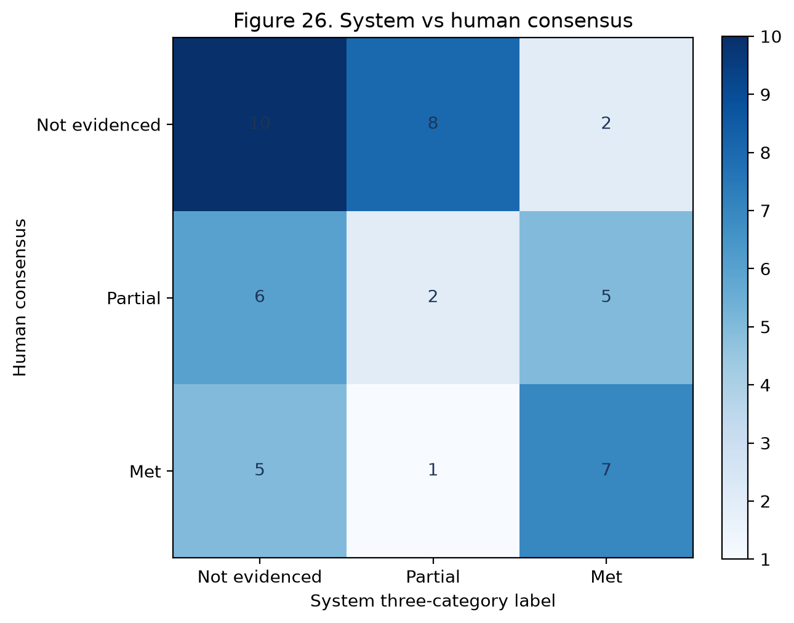
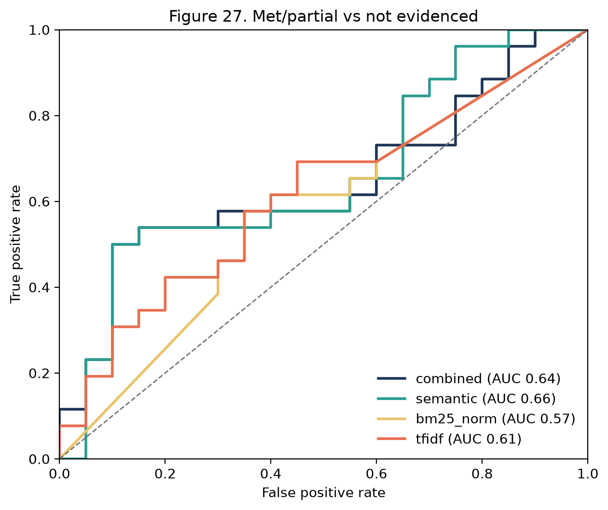
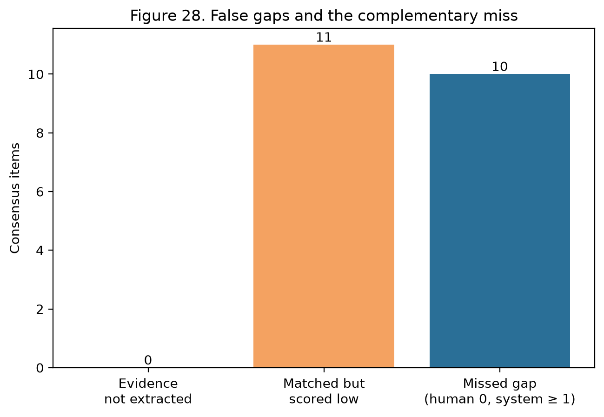
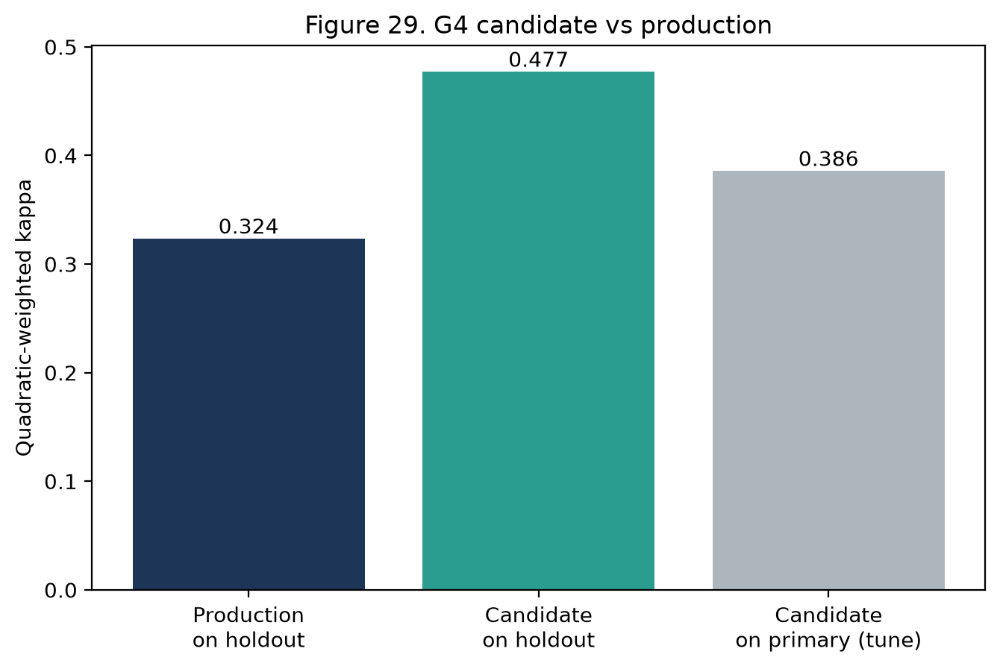
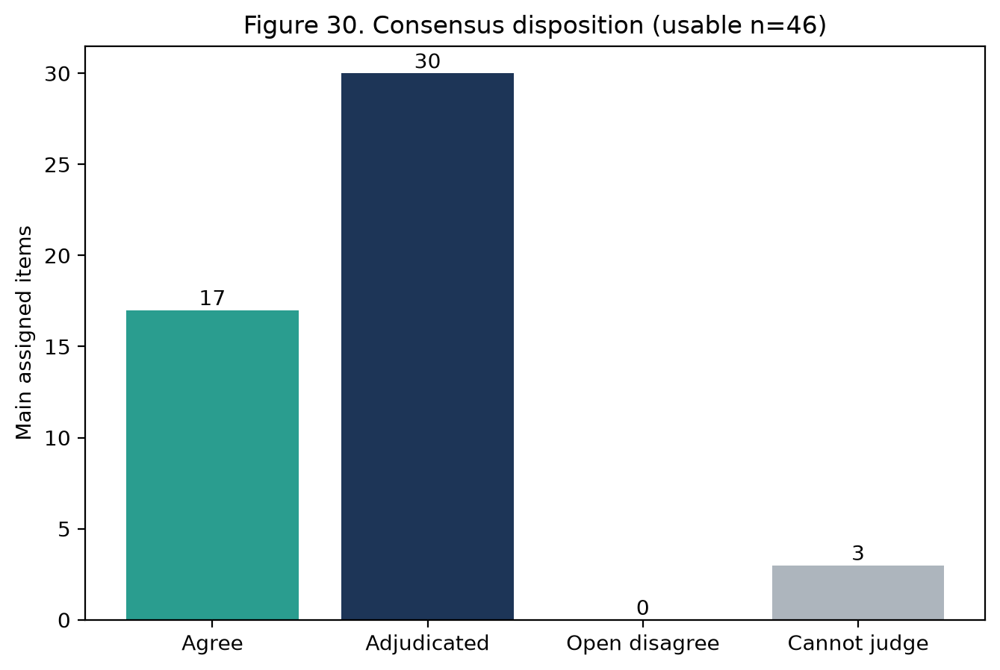
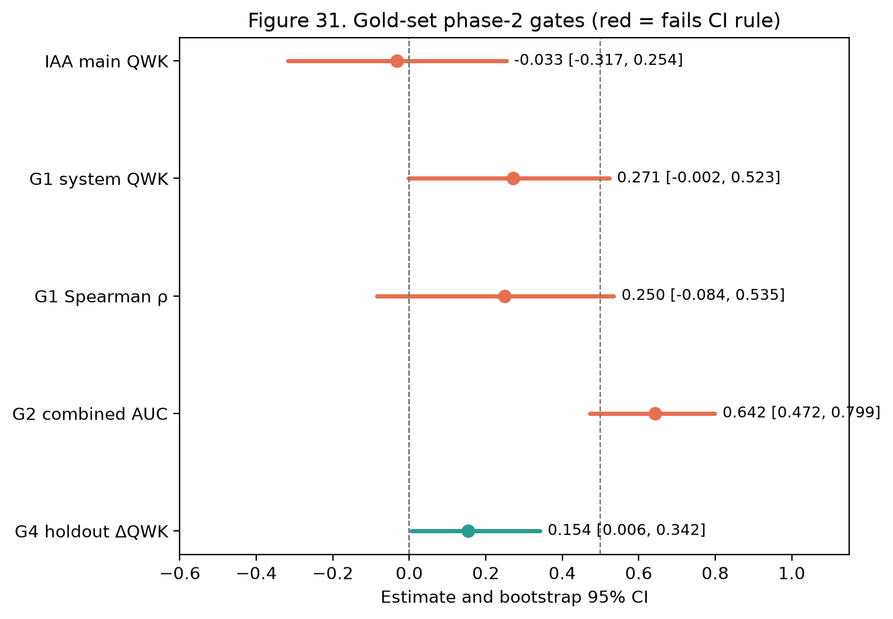

# Gold-set report

Analysis round: `round2_gate_on_unchanged_human_labels`.

Frozen hypotheses: `docs/gold_set_protocol.md` (G1–G4). This file is the phase-2 result. It does not edit the protocol.

G1 interpretation: **False**. Main-pair quadratic kappa has a 95% interval that covers 0 or is undefined. G1 is not interpreted. The hybrid-gap component stays implemented and unvalidated. Calibration items c001–c010 have an adjudicated label. Main-set adjudicated.csv resolved 30 dual-coder disagreements (0 still open; cannot_judge=3).

Human labels are the five files in `experiments/gold_set/annotator_key/` (annotators A–E), copied unchanged into `experiments/gold_set/annotations/` for the runner. No label was imputed. Disagreements without `adjudicated.csv` are excluded from consensus. That exclusion can make agreement with the system look better than it is, so per-annotator quadratic-weighted kappa is reported beside the consensus test.

Assigned main items: 50. Usable consensus: 46. Disposition: `{'agree': 17, 'adjudicated': 30, 'cannot_judge': 3}`.

## Inter-annotator agreement

Main dual-coded pairs (quadratic-weighted kappa, bootstrap 95% CI):

- n pairs = 47
- percent agreement = 0.362
- unweighted kappa = 0.061 [-0.128, 0.251]
- quadratic kappa = -0.033 [-0.317, 0.254] (poor; Landis–Koch is descriptive only)

Calibration, all annotator pairs on the 10 shared items:

- n pairs = 92
- percent agreement = 0.435
- quadratic kappa = 0.269 [0.067, 0.461]

Adjudicated calibration labels, recorded after the discussion. Independent round-1 labels are unchanged. This set is not G1:

- c001=1, c002=1, c003=2, c004=2, c005=0, c006=0, c007=1, c008=0, c009=2, c010=0

- Independent ratings versus the adjudicated label: n = 48, percent agreement = 0.458, quadratic kappa = 0.348 [0.065, 0.575]

- annotator_A: 4/8 match (agreement 0.500, QWK 0.176)
- annotator_B: 3/10 match (agreement 0.300, QWK 0.254)
- annotator_C: 5/10 match (agreement 0.500, QWK 0.420)
- annotator_D: 6/10 match (agreement 0.600, QWK 0.710)
- annotator_E: 4/10 match (agreement 0.400, QWK 0.104)

- System versus adjudicated calibration: n = 10, accuracy = 0.500, QWK = 0.286. Descriptive only. Not G1.

Main-item label counts (0 not evidenced, 1 partial, 2 met). Different use of the scale lowers kappa even when raters are not guessing:

- annotator_A: `{'2': 8, '1': 5, '0': 5, 'cannot_judge': 2}`
- annotator_B: `{'1': 8, '2': 7, '0': 5}`
- annotator_C: `{'2': 6, '0': 10, 'cannot_judge': 1, '1': 3}`
- annotator_D: `{'2': 11, '1': 8, '0': 1}`
- annotator_E: `{'2': 5, '1': 9, '0': 6}`

## G1 — system labels vs human consensus

Supported only if pooled quadratic-weighted kappa has a bootstrap 95% CI entirely above 0 and Spearman rho of combined score vs human label is positive, two-sided p < 0.05, and its bootstrap 95% CI is entirely above 0.

- n = 46
- quadratic-weighted kappa = 0.271 [-0.002, 0.523] (fair; descriptive band only)
- Spearman combined score vs human = 0.250 (p = 0.094, CI [-0.084, 0.535])
- beyond chance: kappa False, Spearman False
- **G1 supported: False**
- Stored three-category labels match the 0.40/0.65 reconstruction on 1.000 of consensus items.

Per-annotator quadratic kappa against the stored system label (sensitivity; disagreements are kept):

- annotator_A: n = 18, QWK = -0.048 [-0.434, 0.357]
- annotator_B: n = 20, QWK = 0.261 [-0.122, 0.594]
- annotator_C: n = 19, QWK = -0.509 [-0.784, -0.057]
- annotator_D: n = 20, QWK = 0.125 [-0.153, 0.452]
- annotator_E: n = 20, QWK = 0.066 [-0.367, 0.493]

Split consensus QWK:

- primary-30: 0.217 [-0.208, 0.595] (n = 22)
- holdout-30: 0.324 [-0.077, 0.651] (n = 24)

## G2 — does the combined score separate met/partial from not evidenced?

Combined score separates met/partial from not-evidenced when its ROC AUC bootstrap 95% CI lies entirely above 0.5. It beats a single signal when the paired AUC difference CI lies entirely above 0.

Pooled n = 46 (positive 26, negative 20).

| Signal | AUC [95% CI] |
| --- | --- |
| combined | 0.642 [0.472, 0.799] |
| tfidf | 0.613 [0.452, 0.771] |
| bm25_norm | 0.573 [0.417, 0.728] |
| semantic | 0.656 [0.483, 0.808] |

Hybrid separates (CI entirely above 0.5): **False**.

- hybrid minus tfidf: delta AUC 0.029 [-0.103, 0.155], beats = False
- hybrid minus bm25_norm: delta AUC 0.069 [-0.017, 0.156], beats = False
- hybrid minus semantic: delta AUC -0.013 [-0.085, 0.046], beats = False

## G3 — false gaps

evidence_not_extracted when the stored matched evidence string is empty; matched_but_scored_low otherwise. Annotator snippet fields are not used, because empty snippets would mis-label every row.

- false gaps = 11 / 46 usable (rate 0.239)
- among items the system called gap: 0.524 (11 / 21)
- evidence not extracted: 0
- matched but scored low: 11
- of those false gaps, requirement phrase is a literal substring of the CV: 0
- complementary error (human not evidenced, system partial or strong): 10 (rate 0.217)

## G4 — recalibration

Grid: signal weights in steps of 0.25 summing to 1; partial threshold in {0.30, 0.35, 0.40, 0.45, 0.50}; strong threshold in {0.55, 0.60, 0.65, 0.70, 0.75}. Objective on the tune split is quadratic-weighted kappa. Ties prefer the configuration closer to production (0.25 / 0.25 / 0.50, thresholds 0.40 / 0.65).

Adoption test tunes on primary-30 (n = 22) and confirms on holdout-30 (n = 24). The search runs only when both splits have at least 8 consensus items.

- evaluable: True
- selected: `{'weights': {'tfidf': 0.25, 'bm25_norm': 0.0, 'semantic': 0.75}, 'partial_threshold': 0.5, 'strong_threshold': 0.55, 'qwk_tune': 0.3857868020304569, 'distance_to_production': 0.7, 'on_grid_boundary': True, 'n_configs_evaluated': 375, 'is_production': False}`
- untouched improvement (candidate QWK − production QWK) = 0.154 [0.006, 0.342]
- production QWK on untouched = 0.324
- candidate QWK on untouched = 0.477
- **adopt recalibration: True**
- reason: Untouched-split QWK gain has a bootstrap 95% CI entirely above 0.

Reverse split (tune on holdout, confirm on primary) is a sensitivity. It is not an adoption test.

- reverse adopt flag (ignored): False
- reverse improvement = -0.044 [-0.201, 0.123]

## Figures

## What this does to question generation

Round 2 does not interpret G1. The five annotators' main-set quadratic kappa still has a 95% interval covering 0. Main-set adjudicated.csv resolved 30 dual-coder disagreements (0 still open; cannot_judge=3). The hybrid gap matrix stays an implemented, unvalidated component. G4's frozen adoption test is True on this consensus (holdout ΔQWK CI excludes 0); the reverse-split sensitivity does not adopt. This run does not rewrite stored gap artifacts. Because G1 remains uninterpreted, treat the G4 candidate as a locked sensitivity configuration pending an explicit production cutover decision.

