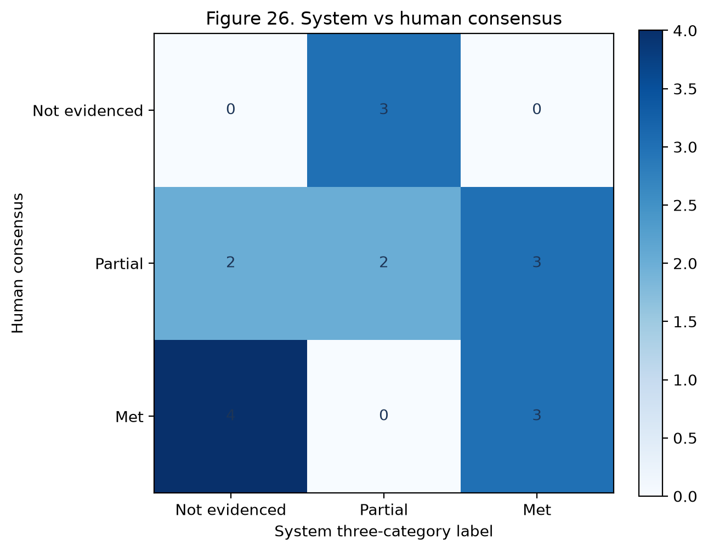
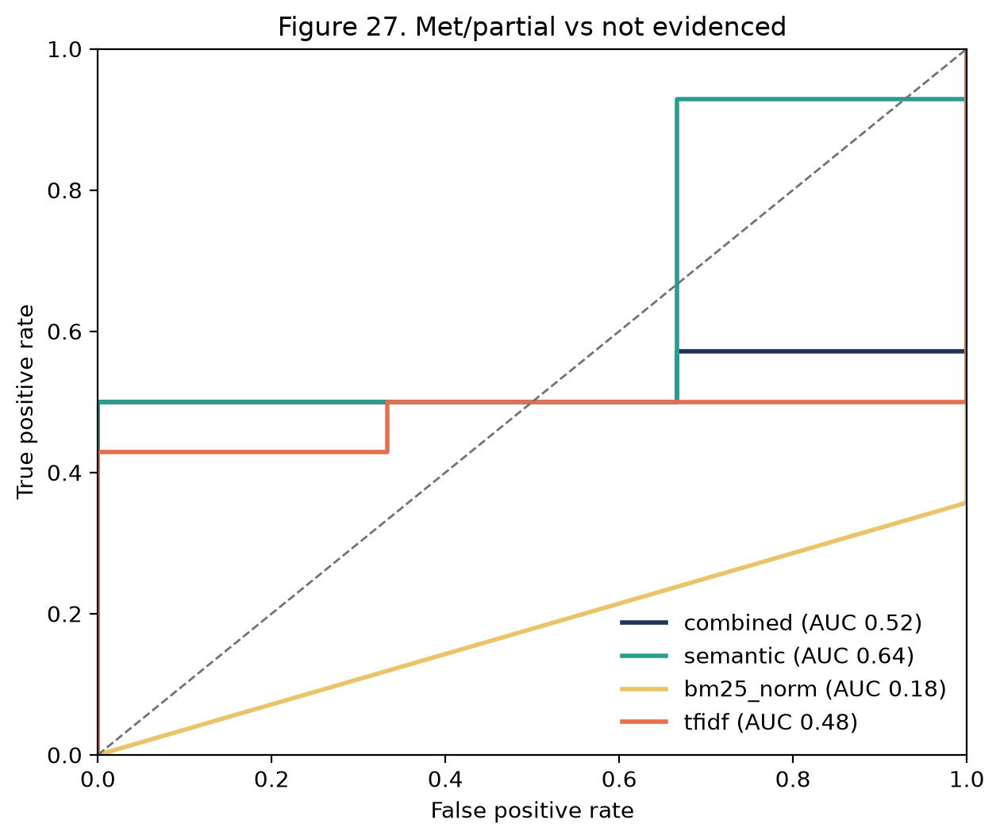
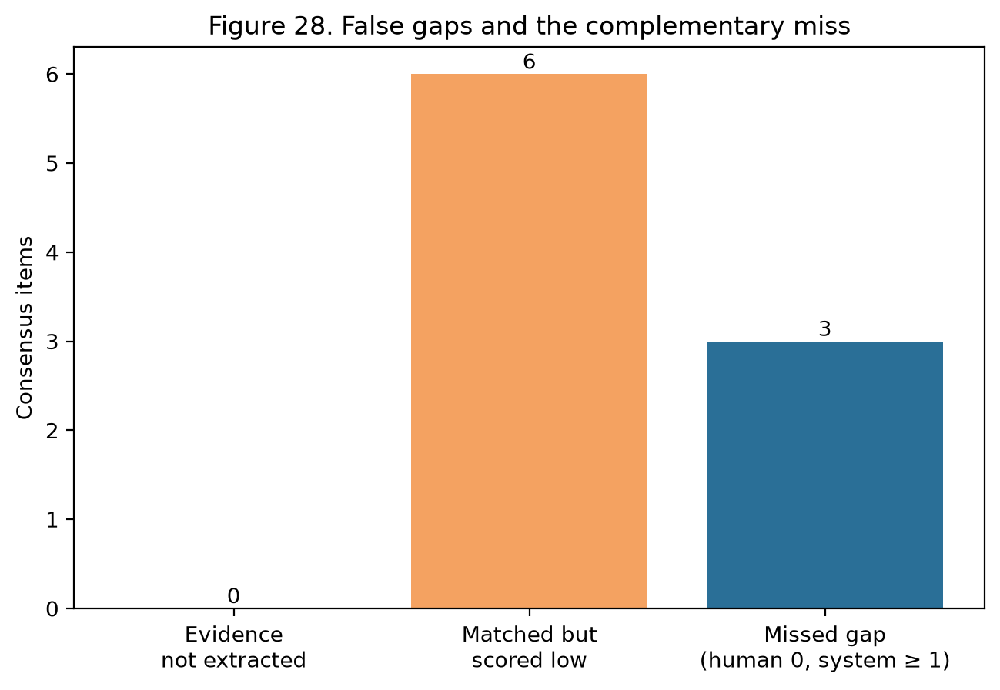
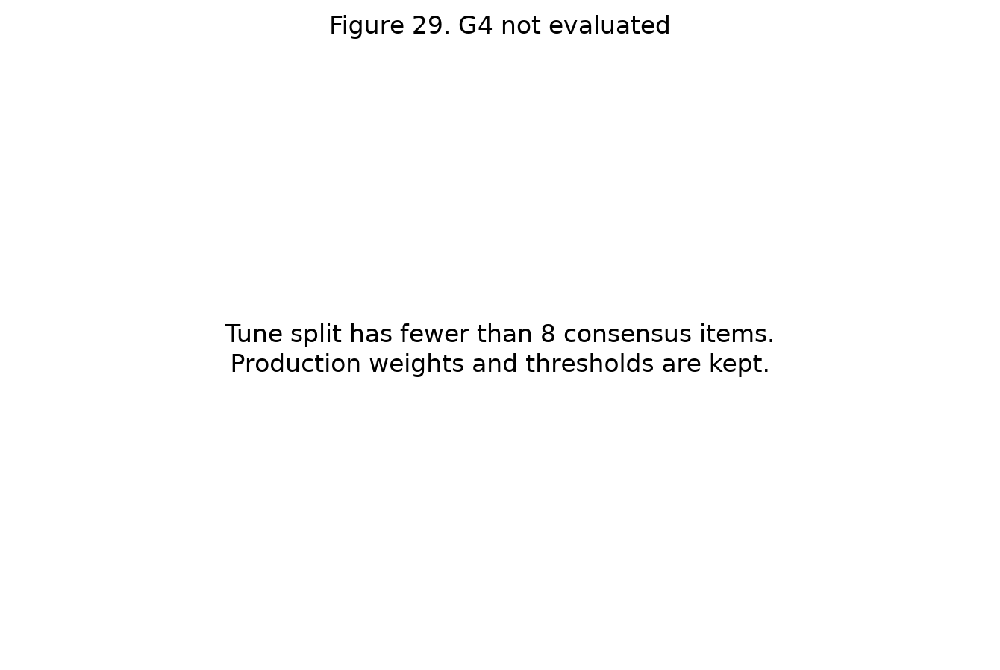

# Gold-set report

Frozen hypotheses: `docs/gold_set_protocol.md` (G1–G4). This file is the phase-2 result. It does not edit the protocol.

Human labels are the five files in `experiments/gold_set/annotator_key/` (annotators A–E), copied unchanged into `experiments/gold_set/annotations/` for the runner. No label was imputed. Disagreements without `adjudicated.csv` are excluded from consensus. That exclusion can make agreement with the system look better than it is, so per-annotator quadratic-weighted kappa is reported beside the consensus test.

Assigned main items: 50. Usable consensus: 17. Disposition: `{'agree': 17, 'disagree': 30, 'cannot_judge': 3}`.

## Inter-annotator agreement

Main dual-coded pairs (quadratic-weighted kappa, bootstrap 95% CI):

- n pairs = 47
- percent agreement = 0.362
- unweighted kappa = 0.061 [-0.128, 0.251]
- quadratic kappa = -0.033 [-0.317, 0.254] (poor; Landis–Koch is descriptive only)

Calibration, all annotator pairs on the 10 shared items:

- n pairs = 92
- percent agreement = 0.435
- quadratic kappa = 0.269 [0.067, 0.461]

Main-item label counts (0 not evidenced, 1 partial, 2 met). Different use of the scale lowers kappa even when raters are not guessing:

- annotator_A: `{'2': 8, '1': 5, '0': 5, 'cannot_judge': 2}`
- annotator_B: `{'1': 8, '2': 7, '0': 5}`
- annotator_C: `{'2': 6, '0': 10, 'cannot_judge': 1, '1': 3}`
- annotator_D: `{'2': 11, '1': 8, '0': 1}`
- annotator_E: `{'2': 5, '1': 9, '0': 6}`

## G1 — system labels vs human consensus

Supported only if pooled quadratic-weighted kappa has a bootstrap 95% CI entirely above 0 and Spearman rho of combined score vs human label is positive, two-sided p < 0.05, and its bootstrap 95% CI is entirely above 0.

- n = 17
- quadratic-weighted kappa = -0.091 [-0.431, 0.324] (poor; descriptive band only)
- Spearman combined score vs human = -0.079 (p = 0.762, CI [-0.576, 0.481])
- beyond chance: kappa False, Spearman False
- **G1 supported: False**
- Stored three-category labels match the 0.40/0.65 reconstruction on 1.000 of consensus items.

Per-annotator quadratic kappa against the stored system label (sensitivity; disagreements are kept):

- annotator_A: n = 18, QWK = -0.048 [-0.434, 0.357]
- annotator_B: n = 20, QWK = 0.261 [-0.122, 0.594]
- annotator_C: n = 19, QWK = -0.509 [-0.784, -0.057]
- annotator_D: n = 20, QWK = 0.125 [-0.153, 0.452]
- annotator_E: n = 20, QWK = 0.066 [-0.367, 0.493]

Split consensus QWK:

- primary-30: -0.182 [-0.565, 0.106] (n = 7)
- holdout-30: 0.000 [-0.539, 0.478] (n = 10)

## G2 — does the combined score separate met/partial from not evidenced?

Combined score separates met/partial from not-evidenced when its ROC AUC bootstrap 95% CI lies entirely above 0.5. It beats a single signal when the paired AUC difference CI lies entirely above 0.

Pooled n = 17 (positive 14, negative 3).

| Signal | AUC [95% CI] |
| --- | --- |
| combined | 0.524 [0.267, 0.784] |
| tfidf | 0.476 [0.214, 0.733] |
| bm25_norm | 0.179 [0.062, 0.312] |
| semantic | 0.643 [0.286, 1.000] |

Hybrid separates (CI entirely above 0.5): **False**.

- hybrid minus tfidf: delta AUC 0.048 [-0.095, 0.214], beats = False
- hybrid minus bm25_norm: delta AUC 0.345 [0.156, 0.542], beats = True
- hybrid minus semantic: delta AUC -0.119 [-0.438, 0.000], beats = False

## G3 — false gaps

evidence_not_extracted when the stored matched evidence string is empty; matched_but_scored_low otherwise. Annotator snippet fields are not used, because empty snippets would mis-label every row.

- false gaps = 6 / 17 usable (rate 0.353)
- among items the system called gap: 1.000 (6 / 6)
- evidence not extracted: 0
- matched but scored low: 6
- of those false gaps, requirement phrase is a literal substring of the CV: 0
- complementary error (human not evidenced, system partial or strong): 3 (rate 0.176)

## G4 — recalibration

Grid: signal weights in steps of 0.25 summing to 1; partial threshold in {0.30, 0.35, 0.40, 0.45, 0.50}; strong threshold in {0.55, 0.60, 0.65, 0.70, 0.75}. Objective on the tune split is quadratic-weighted kappa. Ties prefer the configuration closer to production (0.25 / 0.25 / 0.50, thresholds 0.40 / 0.65).

Adoption test tunes on primary-30 (n = 7) and confirms on holdout-30 (n = 10). The search runs only when both splits have at least 8 consensus items.

- evaluable: False
- selected: `None`
- untouched improvement (candidate QWK − production QWK) = n/a
- production QWK on untouched = n/a
- candidate QWK on untouched = n/a
- **adopt recalibration: False**
- reason: Need at least 8 consensus items on each split.

Reverse split (tune on holdout, confirm on primary) is a sensitivity. It is not an adoption test.

- reverse adopt flag (ignored): False
- reverse improvement = n/a

## Figures

## What this does to question generation

G1 is not supported. The production gap label is not a validated map of what a human finds in the CV. Questions aimed at those gap labels are not yet personalization. Keep the production scorer, and do not describe competency-weighted MMR as gap-validated. The combined score does not separate human met/partial from not-evidenced under the CI rule. Targeting questions at low combined scores is not a reliable way to find un-evidenced requirements. On the consensus subset, 6 of 6 system-gap items were judged met or partial (0 with no stored evidence string, 6 with a stored neighbor). The requirement phrase is a literal substring of the CV in 0 of those false gaps. A stored neighbor that is a different competency, plus an absent phrase, is not the same failure as finding the right evidence and scoring it low. The 6-item count is also not a population rate, because items without rater consensus are excluded. G4 does not adopt a new configuration. Production weights 0.25/0.25/0.50 and thresholds 0.65/0.40/0.20 stay. The next gain in question quality is selection balance on the pools already generated, not another threshold search on these items.

