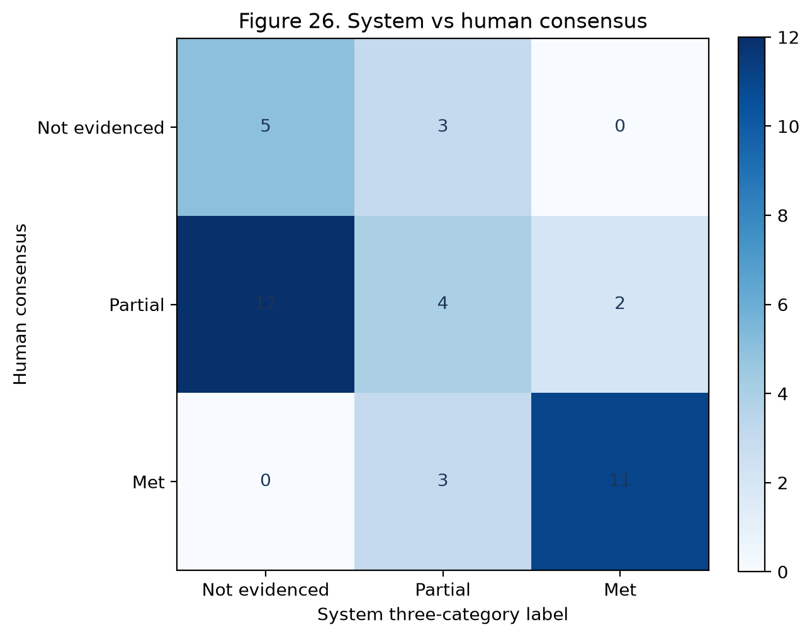
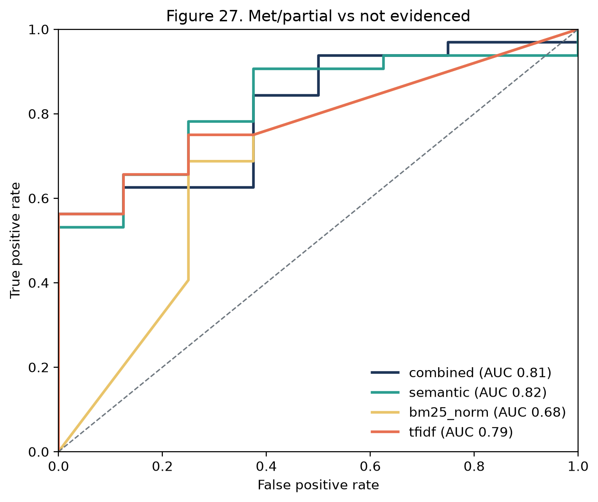
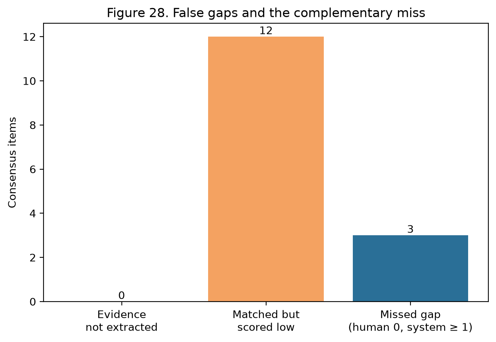
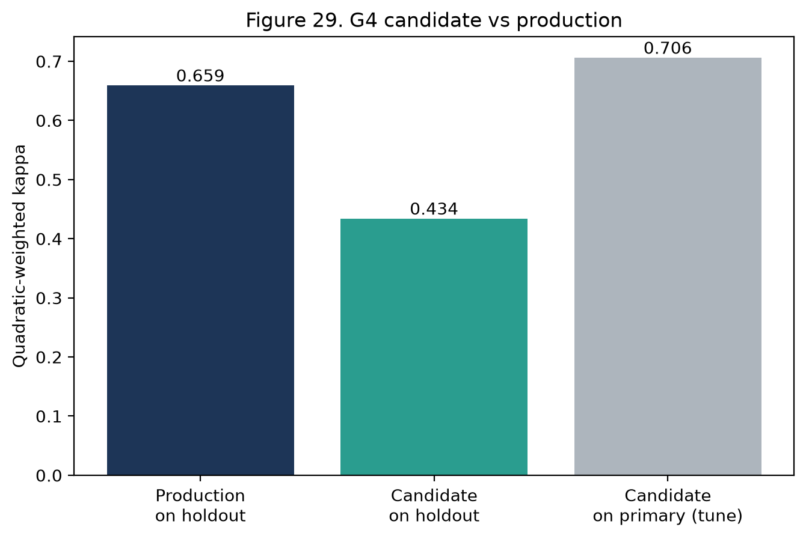
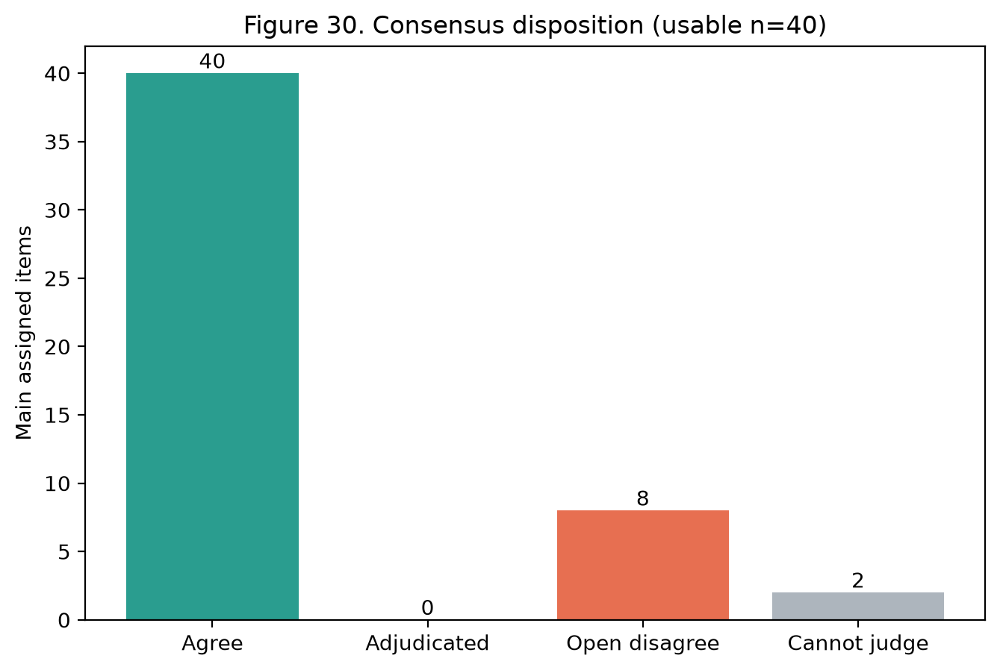
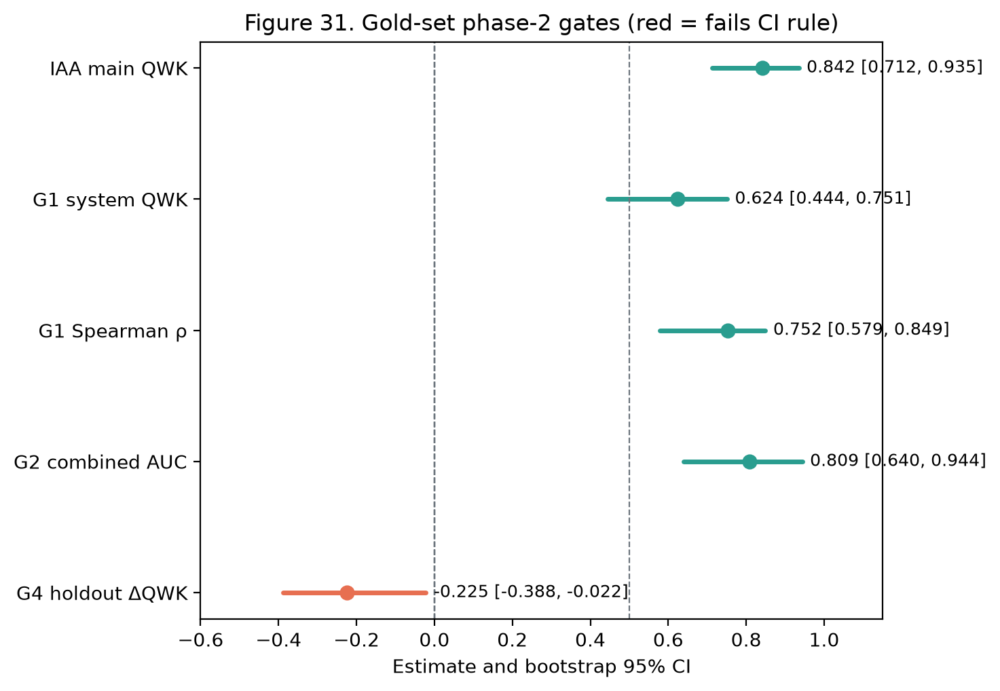

# Gold-set round 3 report

> **Integrity:** LLM dual-coders P1/P2 under the worked-rule brief. Round 1–2 human results remain the official historical record (`docs/gold_set_report.md`). This round tests whether worked-rule retraining can clear the IAA interpretation gate on the **same pack**.

Analysis round: `round3_worked_rule_llm_dual_coding`.

Frozen hypotheses: `docs/gold_set_protocol.md` (G1–G4). This file is the phase-2 result. It does not edit the protocol.

G1 interpretation: **True**. Main-pair quadratic kappa has a 95% CI entirely above 0, so G1 may be read. Main-set disagreements have no adjudicated.csv resolution.

Round-3 labels are **LLM dual-coders** `annotator_P1` (luna/CLASSIFICATION) and `annotator_P2` (terra/PROFILE_ANALYSIS) under `experiments/gold_set/round3/training/worked_rule_brief.md`. Same frozen pack (seed 20261004), same 50 main items. No system labels were shown. Disagreements without `adjudicated.csv` are excluded from consensus. This does **not** replace human round 1–2 for the thesis human-validation claim.

Assigned main items: 50. Usable consensus: 40. Disposition: `{'agree': 40, 'disagree': 8, 'cannot_judge': 2}`.

## Inter-annotator agreement

Main dual-coded pairs (quadratic-weighted kappa, bootstrap 95% CI):

- n pairs = 48
- percent agreement = 0.833
- unweighted kappa = 0.738 [0.557, 0.892]
- quadratic kappa = 0.842 [0.712, 0.935] (almost_perfect; Landis–Koch is descriptive only)

Calibration, all annotator pairs on the 10 shared items:

- n pairs = 0
- percent agreement = n/a
- quadratic kappa = n/a

Adjudicated calibration labels, recorded after the discussion. Independent round-1 labels are unchanged. This set is not G1:

- c001=1, c002=1, c003=2, c004=2, c005=0, c006=0, c007=1, c008=0, c009=2, c010=0

- Independent ratings versus the adjudicated label: n = 0, percent agreement = n/a, quadratic kappa = n/a [n/a, n/a]

- annotator_P1: 0/0 match (agreement n/a, QWK n/a)
- annotator_P2: 0/0 match (agreement n/a, QWK n/a)

- System versus adjudicated calibration: n = 10, accuracy = 0.500, QWK = 0.286. Descriptive only. Not G1.

Main-item label counts (0 not evidenced, 1 partial, 2 met). Different use of the scale lowers kappa even when raters are not guessing:

- annotator_P1: `{'2': 15, '1': 23, '0': 10, 'cannot_judge': 2}`
- annotator_P2: `{'2': 17, '1': 21, '0': 10, 'cannot_judge': 2}`

## G1 — system labels vs human consensus

Supported only if pooled quadratic-weighted kappa has a bootstrap 95% CI entirely above 0 and Spearman rho of combined score vs human label is positive, two-sided p < 0.05, and its bootstrap 95% CI is entirely above 0.

- n = 40
- quadratic-weighted kappa = 0.624 [0.444, 0.751] (substantial; descriptive band only)
- Spearman combined score vs human = 0.752 (p = 0.000, CI [0.579, 0.849])
- beyond chance: kappa True, Spearman True
- **G1 supported: True**
- Stored three-category labels match the 0.40/0.65 reconstruction on 1.000 of consensus items.

Per-annotator quadratic kappa against the stored system label (sensitivity; disagreements are kept):

- annotator_P1: n = 48, QWK = 0.601 [0.430, 0.735]
- annotator_P2: n = 48, QWK = 0.587 [0.400, 0.734]

Split consensus QWK:

- primary-30: 0.574 [0.378, 0.698] (n = 20)
- holdout-30: 0.659 [0.369, 0.838] (n = 20)

## G2 — does the combined score separate met/partial from not evidenced?

Combined score separates met/partial from not-evidenced when its ROC AUC bootstrap 95% CI lies entirely above 0.5. It beats a single signal when the paired AUC difference CI lies entirely above 0.

Pooled n = 40 (positive 32, negative 8).

| Signal | AUC [95% CI] |
| --- | --- |
| combined | 0.809 [0.640, 0.944] |
| tfidf | 0.793 [0.652, 0.909] |
| bm25_norm | 0.684 [0.454, 0.891] |
| semantic | 0.824 [0.658, 0.953] |

Hybrid separates (CI entirely above 0.5): **True**.

- hybrid minus tfidf: delta AUC 0.016 [-0.069, 0.098], beats = False
- hybrid minus bm25_norm: delta AUC 0.125 [0.000, 0.260], beats = False
- hybrid minus semantic: delta AUC -0.016 [-0.136, 0.080], beats = False

## G3 — false gaps

evidence_not_extracted when the stored matched evidence string is empty; matched_but_scored_low otherwise. Annotator snippet fields are not used, because empty snippets would mis-label every row.

- false gaps = 12 / 40 usable (rate 0.300)
- among items the system called gap: 0.706 (12 / 17)
- evidence not extracted: 0
- matched but scored low: 12
- of those false gaps, requirement phrase is a literal substring of the CV: 0
- complementary error (human not evidenced, system partial or strong): 3 (rate 0.075)

## G4 — recalibration

Grid: signal weights in steps of 0.25 summing to 1; partial threshold in {0.30, 0.35, 0.40, 0.45, 0.50}; strong threshold in {0.55, 0.60, 0.65, 0.70, 0.75}. Objective on the tune split is quadratic-weighted kappa. Ties prefer the configuration closer to production (0.25 / 0.25 / 0.50, thresholds 0.40 / 0.65).

Adoption test tunes on primary-30 (n = 20) and confirms on holdout-30 (n = 20). The search runs only when both splits have at least 8 consensus items.

- evaluable: True
- selected: `{'weights': {'tfidf': 0.0, 'bm25_norm': 0.0, 'semantic': 1.0}, 'partial_threshold': 0.3, 'strong_threshold': 0.65, 'qwk_tune': 0.7058823529411765, 'distance_to_production': 1.1, 'on_grid_boundary': True, 'n_configs_evaluated': 375, 'is_production': False}`
- untouched improvement (candidate QWK − production QWK) = -0.225 [-0.388, -0.022]
- production QWK on untouched = 0.659
- candidate QWK on untouched = 0.434
- **adopt recalibration: False**
- reason: Untouched-split QWK gain CI does not lie entirely above 0. Keep production weights and thresholds.

Reverse split (tune on holdout, confirm on primary) is a sensitivity. It is not an adoption test.

- reverse adopt flag (ignored): False
- reverse improvement = 0.005 [-0.216, 0.213]

## Figures

## What this does to question generation

**Caveat first:** these consensus labels are rule-trained LLM dual-coders, not new human annotators. Do not cite this paragraph as human validation.

G1 is supported on the round-3 consensus items. Under this label source, gap labels carry rule-aligned signal, so conditioning a question pool on the gap matrix is more defensible than after human rounds 1–2 alone — contingent on treating round 3 as exploratory. The hybrid score separates the human binary, but it does not beat every single signal under the CI rule. Keep the hybrid as the production score. Do not claim it dominates TF-IDF, BM25, and semantic similarity. On the consensus subset, 12 of 17 system-gap items were judged met or partial (0 with no stored evidence string, 12 with a stored neighbor). The requirement phrase is a literal substring of the CV in 0 of those false gaps. A stored neighbor that is a different competency, plus an absent phrase, is not the same failure as finding the right evidence and scoring it low. The 6-item count is also not a population rate, because items without rater consensus are excluded. G4 does not adopt a new configuration. Production weights 0.25/0.25/0.50 and thresholds 0.65/0.40/0.20 stay. The next gain in question quality is selection balance on the pools already generated, not another threshold search on these items.

