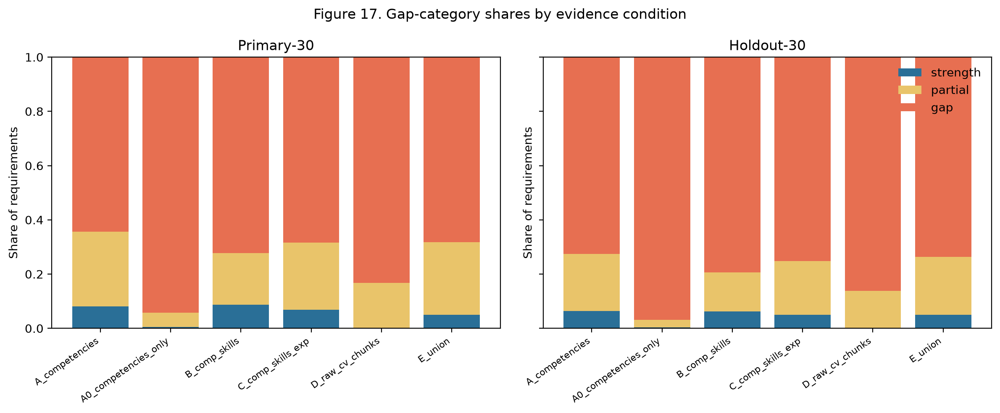
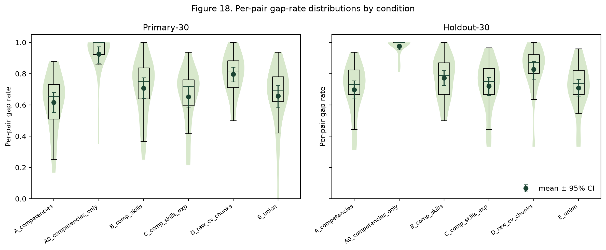
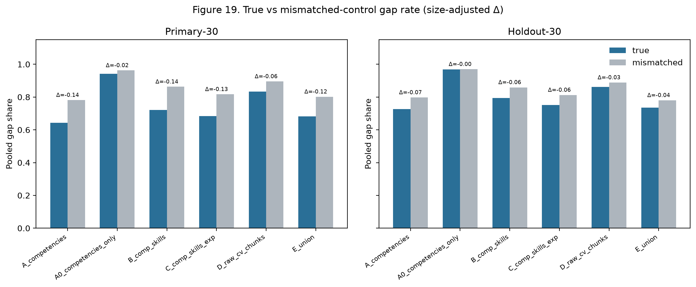
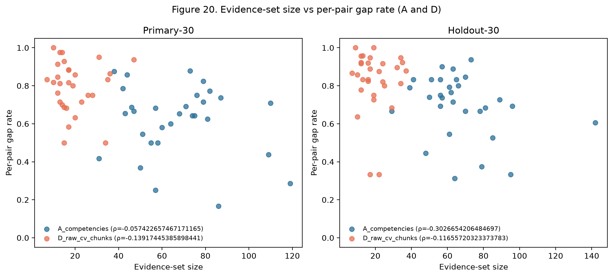
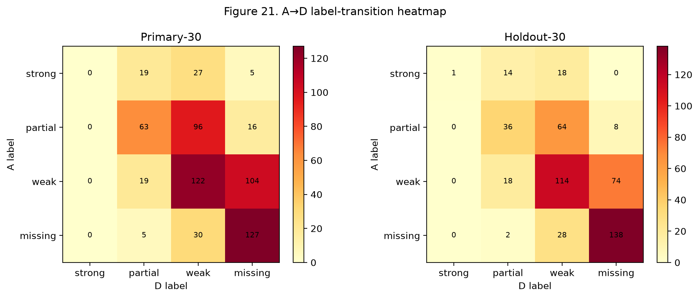

# InterviewIQ — Project Report

**Research-grade interview question generation with profile-gap analysis**

| Field | Value |
| --- | --- |
| Repository | `interviewIQ` |
| Report date | 2026-10-03 |
| Primary dataset | [`cnamuangtoun/resume-job-description-fit`](https://huggingface.co/datasets/cnamuangtoun/resume-job-description-fit) |
| Generation model (controlled) | `gpt-5.6-terra` |
| Extraction model | `gpt-5.6-luna` |
| Embedding model | `all-MiniLM-L6-v2` |
| Related deep-dive | [Gap sensitivity report](gap_sensitivity_report.md) |

---

## 1. Executive summary

InterviewIQ is a research system for generating interview questions that are conditioned on **structured candidate–job profile gaps**, rather than a single flat prompt over raw CV and JD text. The repository implements:

1. A **legacy flat-prompt baseline** (`interviewiq_baseline/`, historically `gpt-4o`).
2. A **FastAPI application** with Luna/Terra routing, TF-IDF + BM25 + semantic retrieval, gap matrix labelling, competency weighting, and competency-weighted MMR.
3. An **experiment runner** with stages for baseline generation, Luna extraction, gap analysis, and evidence-set sensitivity analysis.
4. A **Next.js research console** for browsing runs, costs, and question sets.

**Work completed so far (quantitative):**

| Workstream | Status | Headline result |
| --- | --- | --- |
| Local fit classifier | Done | Test accuracy 0.464, macro-F1 0.424 (not used as thesis DV) |
| Terra baseline generation | Done | 30-pair and 150-pair runs; 10 questions/pair; ~$0.25 / ~$1.15 |
| Luna extraction (Primary-30) | Done | 30/30 pairs; $0.213; mean ~2.8 competencies vs ~24 tech skills |
| Luna extraction (Holdout-30) | Done | 30/30 pairs; $0.196 |
| Gap analysis (Primary-30) | Done | 633 requirements → **64.3%** gap (weak+missing) |
| Gap analysis (Holdout-30) | Done | 515 requirements → **72.6%** gap |
| Evidence-set sensitivity | Done | Competencies-only would inflate gaps to 94–97%; raw CV does **not** beat production evidence |
| Full InterviewIQ question generation | Not yet run as controlled experiment | Pipeline modules exist; Terra pool + MMR stage pending batch eval |
| Human evaluation | Not yet | Runner marks `human_evaluation: not_yet_evaluated` |

**Thesis-relevant takeaway from gap work:** the stored high gap rate is **not** an artefact of scoring only ~2.7 extracted competencies—the production scorer already uses an expanded evidence union (~67 strings/pair). Substituting raw CV chunks does not reduce gaps. Restricting evidence to competencies alone *would* inflate gaps to ~94–97%, and that inflation exceeds a mismatched-candidate size-bias control.

---

## 2. Research goals and design

### 2.1 Independent variable

**Generation methodology**, holding candidate, job, generation model, decoding config, final question count \(N\), and evaluation criteria fixed.

| Mode | Pipeline |
| --- | --- |
| **Baseline** | CV + JD (+ seniority) → Terra → \(N\) questions. No gap matrix, no competency weights, no MMR. |
| **InterviewIQ** | Extract → normalize → TF-IDF/BM25/semantic → gap matrix → weights → Terra question pool → redundancy filter → competency-weighted MMR → \(N\) questions |

Do **not** compare a Luna baseline against a Terra InterviewIQ condition.

### 2.2 Research integrity rules

- No fabricated experiment numbers; unavailable metrics are `null`.
- Model IDs are configuration-driven; business logic selects an `LLMTask`, never a hard-coded model string.
- Fail closed on invalid API key / model ID (no silent substitution).
- Luna/Terra are never fine-tuned; only a local embedding + logistic-regression fit classifier is trained.

---

## 3. System architecture

```
CV/JD text
  → Luna structured extraction (CandidateProfile / JobDescription)
  → TF-IDF + BM25 + Sentence-Transformers
  → profile-gap matrix + competency weights
  → Terra question pool (application path)
  → question embeddings + redundancy filter
  → competency-weighted MMR
  → final question set
```

### 3.1 Repository layout

| Path | Role |
| --- | --- |
| `backend/` | FastAPI app: config, LLM router, retrieval, embeddings, gap analysis, MMR, gap sensitivity |
| `prompts/` | Versioned prompt files (extraction, generation, validation) |
| `experiments/` | YAML configs, runner, datasets, result artifacts |
| `frontend/` | Next.js research console |
| `interviewiq_baseline/` | Preserved flat-prompt prototype (`gpt-4o`) |
| `docs/` | Architecture, routing, experiments, sensitivity report, figures |

### 3.2 Stack

- **Backend:** FastAPI, Pydantic v2, OpenAI SDK  
- **Retrieval:** scikit-learn TF-IDF, `rank-bm25`  
- **Embeddings:** Sentence-Transformers `all-MiniLM-L6-v2` (CPU or CUDA)  
- **Persistence:** file-based `experiments/results/<exp_id>/`  
- **Frontend:** Next.js (experiment list, charts, question inspector, CV/JD upload)

### 3.3 LLM routing

| Task class | Model env | Default |
| --- | --- | --- |
| Extraction, normalization, validation | `LLM_FAST_MODEL` | `gpt-5.6-luna` |
| Profile/gap interpretation, question generation/refinement | `LLM_PRIMARY_MODEL` | `gpt-5.6-terra` |

Default pricing (overridable via env; from OpenAI docs as of 2026-09-20):

- Terra: $2.00 / $0.20 cached / $12.00 output per 1M tokens  
- Luna: $0.20 / $0.02 cached / $1.20 output per 1M tokens  

### 3.4 Gap scoring (deterministic core)

For each job requirement against candidate evidence strings:

\[
\text{combined} = 0.25\cdot\text{tfidf} + 0.25\cdot\text{bm25\_norm} + 0.50\cdot\text{semantic}
\]

| Label | Threshold on combined |
| --- | --- |
| strong | ≥ 0.65 |
| partial | ≥ 0.40 |
| weak | ≥ 0.20 |
| missing | &lt; 0.20 |

**Three-category matrix used in reporting:** strength = strong; partial = partial; **gap = weak + missing**.

`bm25_norm` = raw BM25 / max raw BM25 over requirements in the same pair (evidence-set dependent). Semantic similarity uses max cosine over candidate strings (`all-MiniLM-L6-v2`).

Ablation flags in settings can independently disable TF-IDF, BM25, semantic, gap analysis, weighting, MMR, and redundancy filtering.

---

## 4. Dataset and pair curation

### 4.1 Hugging Face resume–job fit dataset

| Split | Rows | Labels |
| --- | ---: | --- |
| train | 6,241 | No Fit / Potential Fit / Good Fit |
| test | 1,759 | same |

Columns: `resume_text`, `job_description_text`, `label`.

### 4.2 Local fit classifier (calibration aid, not thesis DV)

Trained on train split; evaluated on test. Embedding model: `all-MiniLM-L6-v2`. Artifact: `experiments/datasets/resume_job_fit/models/fit_classifier_metrics.json` (trained 2026-09-20).

| Metric | Value |
| --- | ---: |
| Accuracy | 0.464 |
| Macro-F1 | 0.424 |
| Weighted-F1 | 0.462 |

**Per-class (test):**

| Class | Precision | Recall | F1 | Support |
| --- | ---: | ---: | ---: | ---: |
| No Fit | 0.574 | 0.600 | 0.587 | 857 |
| Potential Fit | 0.319 | 0.351 | 0.334 | 444 |
| Good Fit | 0.389 | 0.319 | 0.351 | 458 |

**Confusion matrix** (rows = true, cols = predicted; order No Fit / Potential Fit / Good Fit):

|  | Pred No Fit | Pred Potential | Pred Good |
| ---: | ---: | ---: | ---: |
| True No Fit | 514 | 205 | 138 |
| True Potential | 197 | 156 | 91 |
| True Good | 184 | 128 | 146 |

### 4.3 Experiment pair subsets

Stratified **Good Fit** and **Potential Fit** pairs for generation / extraction (No Fit excluded from interview-question experiments).

| Subset | Pairs | Composition | Config |
| --- | ---: | --- | --- |
| `experiment_pairs` | 30 | 15 Good + 15 Potential | `primary_hf.yaml` (seed 42) |
| `experiment_pairs_holdout30` | 30 | 15 + 15 | `primary_hf_holdout30.yaml` (seed 2026) |
| `experiment_pairs_150` | 150 | 75 + 75 | `primary_hf_150.yaml` |

---

## 5. Experiment inventory

All artifacts under `experiments/results/`. Status values and costs are taken from each run’s `summary.json` (not estimated).

### 5.1 Baseline generation (Terra)

| Experiment ID | Status | Pairs | Questions/pair | Cost (USD) | Mean latency (ms) | Notes |
| --- | --- | ---: | ---: | ---: | ---: | --- |
| `exp_20260920T210557Z` | failed | 3 | — | 0 | — | Early smoke failures |
| `exp_20260920T210619Z` | failed | 3 | — | 0 | — | Early smoke failures |
| `exp_20260920T212014Z` | failed | 3 | — | 0 | — | Early smoke failures |
| `exp_20260920T212053Z` | completed | 3 | 10 | 0.018744 | 6402 | Smoke OK |
| `exp_20260920T220958Z` | completed | 30 | 10 | 0.246540 | 5767 | Primary-30 baseline |
| `exp_20260926T221259Z` | completed | 30 | 10 | 0.245712 | 5736 | Primary-30 baseline (repeat) |
| `exp_20260926T223339Z` | completed | 150 | 10 | 1.147875 | 5461 | 150-pair baseline |

### 5.2 Luna extraction

| Experiment ID | Status | Split | Pairs OK | Cost (USD) | Mean latency (ms) | Prompt versions |
| --- | --- | --- | ---: | ---: | ---: | --- |
| `exp_20260927T205539Z` | failed | smoke | 0/1 | 0 | — | 1.0.0 / 1.0.0 |
| `exp_20260927T205622Z` | completed | smoke | 1/1 | 0.010099 | 42274 | 1.0.0 / 1.0.0 |
| **`exp_20260927T205741Z`** | completed | **Primary-30** | 30/30 | **0.213411** | 31260 | 1.0.0 / 1.0.0 |
| `exp_20260927T220439Z` | completed | (30) | 30/30 | 0.207788 | 33233 | Related holdout-path prep |
| **`exp_20260927T221621Z`** | completed | **Holdout-30** | 30/30 | **0.196053** | 32751 | 1.0.0 / 1.0.0 |

### 5.3 Gap analysis

| Experiment ID | Source extraction | Split | Requirements | Strength | Partial | Gaps (weak+missing) | Gap share |
| --- | --- | --- | ---: | ---: | ---: | ---: | ---: |
| `exp_20260927T215127Z` | Primary | smoke (1) | 2 | 1 | 0 | 1 | — |
| **`exp_20260927T215232Z`** | `exp_20260927T205741Z` | **Primary-30** | **633** | **51** | **175** | **407** | **64.3%** |
| **`exp_20260927T223303Z`** | `exp_20260927T221621Z` | **Holdout-30** | **515** | **33** | **108** | **374** | **72.6%** |

Four-label breakdown (same runs):

| Split | Strong | Partial | Weak | Missing |
| --- | ---: | ---: | ---: | ---: |
| Primary-30 | 51 | 175 | 245 | 162 |
| Holdout-30 | 33 | 108 | 206 | 168 |

### 5.4 Gap-sensitivity analysis (local, zero LLM cost)

| Experiment ID | Split | Source extraction | Stored gap (regression target) |
| --- | --- | --- | --- |
| `exp_20261003T042547Z` | Primary-30 | `exp_20260927T205741Z` | `exp_20260927T215232Z` |
| `exp_20261003T042642Z` | Holdout-30 | `exp_20260927T221621Z` | `exp_20260927T223303Z` |
| `exp_20261003T042837Z` | Primary smoke (2 pairs) | — | CLI smoke only |
| `gap_sensitivity_combined/` | both | — | Combined tables, audit, false-gap examples |

Embedding device for sensitivity runs: **CUDA**. Library versions logged in each `summary.json`.

---

## 6. Extraction results (Luna)

Mean / median field counts per pair from stored extraction JSONs:

| Field | Primary-30 mean (median) | Holdout-30 mean (median) |
| --- | --- | --- |
| Competencies | 2.77 (0.5) | 2.57 (0.0) |
| Technical skills | 24.17 (21.0) | 24.40 (24.5) |
| Soft skills | 4.77 (4.0) | 5.17 (5.0) |
| Domain experience | 5.60 (5.0) | 5.10 (5.0) |
| Certifications | 0.43 (0.0) | 0.80 (0.0) |
| Experience responsibilities | 22.13 (22.0) | 22.33 (19.5) |
| Experience achievements | 4.90 (5.0) | 3.50 (4.0) |
| JD required skills | 16.67 (16.0) | 13.43 (12.5) |
| JD preferred skills | 4.43 (2.0) | 3.73 (2.0) |

**Observation:** competencies are sparse relative to technical skills and responsibility bullets. This motivated the evidence-set sensitivity analysis (Section 8).

Production gap scoring (`_candidate_texts`) uses a **deduplicated union** of technical/soft/domain skills, certifications, competencies, and experience technologies + responsibilities—not competencies alone.

---

## 7. Profile-gap matrix results

### 7.1 Primary-30 (`exp_20260927T215232Z`)

- Embedding: `all-MiniLM-L6-v2`; signals: TF-IDF + BM25 + semantic enabled  
- Mean gap-analysis latency: **62.2 ms**/pair  
- **633** requirements → strength 8.1% · partial 27.6% · **gap 64.3%**

### 7.2 Holdout-30 (`exp_20260927T223303Z`)

- Mean latency: **54.7 ms**/pair  
- **515** requirements → strength 6.4% · partial 21.0% · **gap 72.6%**

### 7.3 Breakdown under production evidence (from sensitivity recompute)

| Split | Slice | N req. | Gap share |
| --- | --- | ---: | ---: |
| Primary | Good Fit | 341 | 66.3% |
| Primary | Potential Fit | 292 | 62.0% |
| Primary | required | 500 | 63.4% |
| Primary | preferred | 133 | 67.7% |
| Holdout | Good Fit | 277 | 73.3% |
| Holdout | Potential Fit | 238 | 71.8% |
| Holdout | required | 403 | 69.0% |
| Holdout | preferred | 112 | 85.7% |

Gap rates remain high even on fit-positive pairs, motivating checks for evidence-set / extraction artefacts.

---

## 8. Evidence-set sensitivity analysis

Full methodological detail: [gap_sensitivity_report.md](gap_sensitivity_report.md).  
Combined tables: `experiments/results/gap_sensitivity_combined/`.

### 8.1 Design (held fixed vs varied)

| Held fixed | Varied |
| --- | --- |
| Job requirements | Candidate evidence string set |
| Weights 0.25 / 0.25 / 0.50 | — |
| Thresholds 0.65 / 0.40 / 0.20 | — |
| Embedding model | — |

| Condition | Evidence |
| --- | --- |
| **A** | Production `_candidate_texts` (regression baseline) |
| **A0** | Competencies only |
| **B** | Competencies + technical skills |
| **C** | B + experience title / responsibilities / achievements |
| **D** | Raw CV sentence/bullet chunks (no extraction) |
| **E** | C ∪ D |

**Controls / stats:** mismatched-candidate evidence (5 permutations, seed 42); bootstrap 95% CIs (2000 resamples over pairs); Wilcoxon signed-rank vs A; Spearman size↔gap dose-response; semantic-only robustness.

### 8.2 Regression check

Replaying Condition A against stored gap JSONs:

| Split | Passed | Counts match | Max \|Δ combined\| |
| --- | --- | --- | ---: |
| Primary-30 | Yes | Yes (51/175/245/162) | &lt; 1e-7 |
| Holdout-30 | Yes | Yes (33/108/206/168) | &lt; 1e-7 |

### 8.3 Gap shares and per-pair rates

| Split | Condition | N | Strong | Partial | Weak | Missing | Gap share [95% CI] | Mean per-pair gap [95% CI] | Evid. size mean |
| --- | --- | ---: | ---: | ---: | ---: | ---: | --- | --- | ---: |
| primary | A | 633 | 51 | 175 | 245 | 162 | 64.3% [58.1, 70.2] | 0.617 [0.552, 0.679] | 67.07 |
| primary | A0 | 633 | 3 | 34 | 35 | 561 | 94.2% [89.2, 97.8] | 0.925 [0.868, 0.973] | 2.77 |
| primary | B | 633 | 55 | 121 | 181 | 276 | 72.2% [66.4, 77.6] | 0.708 [0.640, 0.773] | 26.77 |
| primary | C | 633 | 43 | 157 | 259 | 174 | 68.4% [62.7, 73.4] | 0.653 [0.587, 0.717] | 57.13 |
| primary | D | 633 | 0 | 106 | 275 | 252 | 83.3% [78.2, 87.5] | 0.797 [0.749, 0.842] | 19.27 |
| primary | E | 633 | 32 | 169 | 291 | 141 | 68.2% [61.8, 74.1] | 0.657 [0.582, 0.724] | 76.40 |
| holdout | A | 515 | 33 | 108 | 206 | 168 | 72.6% [66.6, 77.9] | 0.698 [0.639, 0.754] | 66.77 |
| holdout | A0 | 515 | 2 | 14 | 32 | 467 | 96.9% [94.5, 98.9] | 0.975 [0.953, 0.991] | 2.57 |
| holdout | B | 515 | 32 | 74 | 138 | 271 | 79.4% [74.0, 84.1] | 0.772 [0.725, 0.820] | 26.97 |
| holdout | C | 515 | 26 | 102 | 197 | 190 | 75.1% [69.4, 80.3] | 0.720 [0.660, 0.776] | 56.23 |
| holdout | D | 515 | 1 | 70 | 224 | 220 | 86.2% [83.1, 89.0] | 0.828 [0.766, 0.877] | 19.47 |
| holdout | E | 515 | 26 | 110 | 224 | 155 | 73.6% [68.9, 78.1] | 0.709 [0.652, 0.763] | 75.70 |

### 8.4 Size-adjusted effects (true − mismatched gap share)

| Condition | Primary Δ | Holdout Δ |
| --- | ---: | ---: |
| A | −0.138 | −0.071 |
| A0 | −0.021 | −0.001 |
| B | −0.141 | −0.065 |
| C | −0.133 | −0.061 |
| D | −0.063 | −0.026 |
| E | −0.119 | −0.044 |

Negative values mean true candidate evidence yields fewer gaps than a random other candidate’s evidence of the same type (matching signal beyond set size).

### 8.5 Wilcoxon vs production A (per-pair gap rate)

Positive rank-biserial ⇒ condition has **higher** gap rate than A.

| Condition | Primary p / \(r_{rb}\) | Holdout p / \(r_{rb}\) |
| --- | --- | --- |
| A0 | ~0 / 1.00 | ~0 / 0.995 |
| B | 0.0013 / 0.84 | 0.0012 / 0.80 |
| C | 0.021 / 0.61 | 0.062 / 0.64 |
| D | ~0 / 1.00 | 0.0002 / 0.83 |
| E | 0.038 / 0.51 | 0.62 / 0.15 |

### 8.6 Spearman dose-response (evidence size vs per-pair gap rate)

| Condition | Primary ρ (p) | Holdout ρ (p) |
| --- | --- | --- |
| A | −0.057 (0.76) | −0.303 (0.10) |
| A0 | **−0.780 (~0)** | **−0.574 (0.0009)** |
| B | 0.111 (0.56) | 0.160 (0.40) |
| C | −0.111 (0.56) | −0.412 (0.024) |
| D | −0.139 (0.46) | −0.117 (0.54) |
| E | −0.151 (0.42) | −0.402 (0.028) |

Strong size↔gap coupling appears mainly under the sparse A0 regime.

### 8.7 Semantic-only robustness (same thresholds on semantic score)

| Condition | Primary gap share | Holdout gap share |
| --- | ---: | ---: |
| A | 38.2% | 45.2% |
| A0 | 90.7% | 93.0% |
| B | 52.8% | 59.4% |
| C | 43.3% | 51.1% |
| D | 71.7% | 73.2% |
| E | 41.1% | 48.5% |

Ordering is consistent with the combined scorer: A0 and D remain worse than production A.

### 8.8 Mean signal values (combined scorer)

| Split | Condition | TF-IDF | BM25_norm | Semantic | Combined |
| --- | --- | ---: | ---: | ---: | ---: |
| primary | A | 0.060 | 0.327 | 0.512 | 0.353 |
| primary | A0 | 0.012 | 0.055 | 0.143 | 0.088 |
| primary | D | 0.053 | 0.316 | 0.335 | 0.260 |
| holdout | A | 0.042 | 0.289 | 0.470 | 0.318 |
| holdout | A0 | 0.006 | 0.040 | 0.130 | 0.076 |
| holdout | D | 0.035 | 0.308 | 0.330 | 0.251 |

### 8.9 Label transitions A → D

**Primary-30**

| from \ to | strong | partial | weak | missing |
| --- | ---: | ---: | ---: | ---: |
| strong | 0 | 19 | 27 | 5 |
| partial | 0 | 63 | 96 | 16 |
| weak | 0 | 19 | 122 | 104 |
| missing | 0 | 5 | 30 | 127 |

**Holdout-30**

| from \ to | strong | partial | weak | missing |
| --- | ---: | ---: | ---: | ---: |
| strong | 1 | 14 | 18 | 0 |
| partial | 0 | 36 | 64 | 8 |
| weak | 0 | 18 | 114 | 74 |
| missing | 0 | 2 | 28 | 138 |

### 8.10 Figures

All figures at 200 dpi under `docs/figures/`.

#### Figure 17 — Gap-category shares by condition



#### Figure 18 — Per-pair gap-rate distributions



#### Figure 19 — True vs mismatched-control gap rate



#### Figure 20 — Evidence-set size vs per-pair gap rate (A and D)



#### Figure 21 — A→D label-transition heatmap



### 8.11 Audit artifacts

| Artifact | Path |
| --- | --- |
| Annotator audit sheet (CSV) | `experiments/results/gap_sensitivity_combined/audit_sheet.csv` |
| Annotator audit sheet (MD) | `experiments/results/gap_sensitivity_combined/audit_sheet.md` |
| Top-25 A→D score-increase examples | `experiments/results/gap_sensitivity_combined/false_gap_examples.md` |
| Cross-split overview CSV | `experiments/results/gap_sensitivity_combined/overview_by_condition.csv` |

Audit annotator columns (`missed_skills_in_cv`, `extraction_recall_estimate`, `notes`) are intentionally blank.

### 8.12 Interpretation for the thesis

1. **Production gap rates (64–73%) already use expanded extracted evidence** (~67 strings/pair). They are not the competencies-only artefact.
2. **Competencies-only (A0) would inflate gaps to 94–97%.** The A0→A reduction (~0.30 primary / ~0.24 holdout) exceeds the mismatched-control change (~0.18 / ~0.17) ⇒ that inflation is partly extraction-coverage, not only size bias.
3. **Raw CV chunks (D) do not reduce gaps vs production A** (gaps rise to 83–86%; mean evidence size ~19 vs ~67). Against raw-CV substitution, the production gap rate **stands**.
4. BM25/TF-IDF scales depend on the evidence set; semantic-only metrics and fixed-bm25 diagnostics mitigate but do not eliminate that confound.

---

## 9. Baseline generation results (Terra)

Controlled baseline: flat prompt, **no** gap matrix / competency budget / MMR. Requested \(N = 10\) questions.

| Run | Pairs | Fit mix | Q/pair | Total cost | Mean latency |
| --- | ---: | --- | ---: | ---: | ---: |
| `exp_20260920T220958Z` | 30 | 15 Good + 15 Potential | 10 | $0.247 | 5.77 s |
| `exp_20260926T221259Z` | 30 | 15 + 15 | 10 | $0.246 | 5.74 s |
| `exp_20260926T223339Z` | 150 | 75 + 75 | 10 | $1.148 | 5.46 s |

Human evaluation of baseline vs InterviewIQ question quality is **not yet completed**.

The legacy `interviewiq_baseline/` package remains as a historical `gpt-4o` prototype; thesis comparisons must use the **same** generation model (Terra) for both conditions.

---

## 10. Application surface

### 10.1 Backend API

- `GET /api/v1/health` — health  
- Pipeline / gap endpoints under `app/api/v1/pipeline.py`  
- Experiment listing / detail under `app/api/v1/experiments.py`  
- System / model routing info under `app/api/v1/system.py`

### 10.2 Frontend research console

- `/` — experiment list + aggregate cost/latency  
- `/experiments/[id]` — latency, cost, token, and fit-label charts; question inspector  
- `/upload` — ad-hoc CV/JD storage for testing  

API base: `NEXT_PUBLIC_API_URL` (default `http://127.0.0.1:8000`).

### 10.3 Experiment runner stages

```bash
# Baseline
PYTHONPATH=backend python -m experiments.run --config experiments/configs/primary_hf.yaml

# Extraction
PYTHONPATH=backend python -m experiments.run --config experiments/configs/primary_hf.yaml --stage extraction

# Gap analysis
PYTHONPATH=backend python -m experiments.run --config experiments/configs/primary_hf.yaml \
  --stage gap_analysis --source-experiment exp_20260927T205741Z

# Gap sensitivity (both splits + figures + report)
PYTHONPATH=backend python experiments/scripts/run_gap_sensitivity.py
```

---

## 11. Testing

Tests mock LLM usage and do not call paid APIs. Prefer `EMBEDDING_MODEL=hashing-test` to avoid downloading Sentence-Transformer weights.

| Suite area | Coverage |
| --- | --- |
| Config / router | Model routing, fail-closed behaviour |
| Retrieval | TF-IDF, BM25 |
| Gap + MMR | Labels, weighting, redundancy, MMR selection |
| Extraction schemas | Pydantic profile parsing |
| Dataset / sources | Resume-fit loading, pair resolution |
| Baseline generation | Prompt path (mocked) |
| API / experiments API | Health and experiment readers |
| **Gap sensitivity** | Chunker, evidence builders, mismatch seeding, bootstrap reproducibility, 2-pair E2E |

As of the sensitivity work: **32 pytest tests passing**.

---

## 12. Cost summary (completed paid LLM stages)

| Stage | Approx. total USD (sum of successful runs cited above) |
| --- | ---: |
| Baseline Terra (30+30+150+smoke) | ≈ 1.66 |
| Luna extraction (primary + holdout + smokes) | ≈ 0.63 |
| Gap analysis | 0 (local embeddings only) |
| Gap sensitivity | 0 (local embeddings + IR only) |

Exact per-run totals are recorded in each experiment’s `summary.json`.

---

## 13. Limitations and open work

### Limitations of completed work

- Gap labels depend on IR + MiniLM similarity, not human adjudication.  
- BM25/TF-IDF normalisation is evidence-set-dependent (documented; semantic-only used as robustness check).  
- Local fit classifier accuracy is modest (~0.46); it is a curation/calibration aid, not a primary outcome.  
- Frontend charts visualise run metadata; they are not substitutes for the thesis figures in `docs/figures/`.  
- Full InterviewIQ **question generation** batch (Terra pool + MMR) vs baseline human eval is still outstanding.

### Recommended next steps

1. Run InterviewIQ generation on the same Primary-30 / Holdout-30 pairs with Terra, logging pool/MMR artifacts.  
2. Blind human evaluation of Baseline vs InterviewIQ question sets.  
3. Optional: fill the gap-sensitivity audit sheet (20 pairs) for extraction-recall estimates.  
4. Optional: ablations of TF-IDF / BM25 / semantic flags under fixed evidence.

---

## 14. Key artifact index

| Artifact | Location |
| --- | --- |
| This report | `docs/project_report.md` |
| Architecture | `docs/architecture.md` |
| LLM routing | `docs/llm-routing.md` |
| Research pipeline | `docs/research-pipeline.md` |
| Gap sensitivity deep-dive | `docs/gap_sensitivity_report.md` |
| Figures 17–21 | `docs/figures/fig17_*.png` … `fig21_*.png` |
| Fit classifier metrics | `experiments/datasets/resume_job_fit/models/fit_classifier_metrics.json` |
| Primary extraction | `experiments/results/exp_20260927T205741Z/` |
| Primary gap analysis | `experiments/results/exp_20260927T215232Z/` |
| Holdout extraction | `experiments/results/exp_20260927T221621Z/` |
| Holdout gap analysis | `experiments/results/exp_20260927T223303Z/` |
| Gap sensitivity (primary) | `experiments/results/exp_20261003T042547Z/` |
| Gap sensitivity (holdout) | `experiments/results/exp_20261003T042642Z/` |
| Combined sensitivity tables | `experiments/results/gap_sensitivity_combined/` |
| Primary-30 Terra baseline | `experiments/results/exp_20260920T220958Z/` |
| 150-pair Terra baseline | `experiments/results/exp_20260926T223339Z/` |

---

## 15. Conclusion

InterviewIQ’s deterministic gap-analysis stack is implemented, tested, and exercised on two 30-pair fit-positive splits. Production scoring yields **64.3%** (primary) and **72.6%** (holdout) gap shares over job requirements. A local sensitivity study shows that (i) those rates already reflect expanded extracted evidence, not competencies-only sparsity; (ii) competencies-only would severely inflate gaps beyond a size-bias control; and (iii) raw CV chunking does not improve on production evidence for this scorer. Terra baseline question sets exist at 30- and 150-pair scale. The remaining critical path for the thesis comparison is **InterviewIQ generation + human evaluation** against those baselines under a matched Terra configuration.
